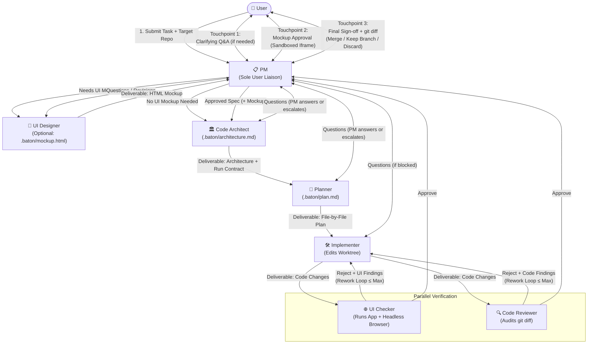
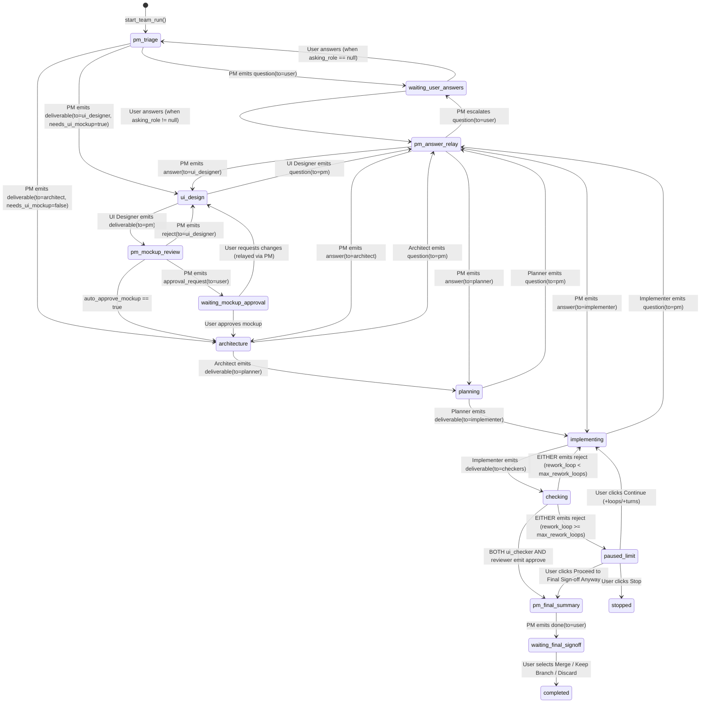

# Baton — Team Mode Architecture & Design Specification (`docs/TEAM_MODE.md`)

---

## 1. User Summary (Plain Language)

### What Team Mode Does
In **Team Mode**, you hand Baton a single task and pick a target project folder. Instead of manually wiring sessions or babysitting each stage, a coordinated **7-agent software engineering team** works together automatically from start to finish:

1. **PM (Product Manager)** — Your single point of contact. Reviews your task and the codebase, asks you clarifying questions if anything is ambiguous, decides whether the task needs a UI mockup, coordinates all specialists, and presents results to you.
2. **UI Designer** *(runs automatically when the task involves UI)* — Builds an interactive HTML mockup of the proposed screen or component changes.
3. **Code Architect** — Designs the technical architecture, data models, API contracts, and how the app is started and tested.
4. **Planner** — Breaks the architecture down into an ordered, file-by-file implementation and verification plan.
5. **Implementer** — Writes the code and unit tests in an isolated Git branch (`baton/<run-id>`) so your working folder is never touched while agents are working.
6. **UI Checker** — Starts the application on a safe local port, opens it in a headless browser, clicks through the UI, checks for console/network errors, and shuts the app down cleanly.
7. **Code Reviewer** — Audits the code diff against the requirements, architecture, and plan for bugs, security issues, and regressions.

### How the Team Collaborates Without You in the Middle
- **Only the PM ever talks to you.** You never have to prompt or manage the other six roles.
- **Internal questions go to the PM first.** If the UI Designer, Code Architect, Planner, or Implementer has a question, they ask the PM. If the PM can answer it from your original instructions or previous answers, the PM answers the specialist directly and work continues automatically. Only if your decision is genuinely required does the PM put a question in your **Inbox**.
- **Automatic rework loops.** After the Implementer finishes coding, the **UI Checker** and **Code Reviewer** run in parallel. If either finds a bug or visual mismatch, their findings are automatically sent back to the Implementer to fix, and both checkers re-verify the fix (up to 3 loops by default).

### What You Will See in the UI
A new **👥 Team** tab in the top bar gives you:
- **Team Setup**: Choose which CLI provider (`Claude` or `AGY`) and model powers each of the 7 roles (pre-loaded with a recommended default team).
- **Live Run Board**: Watch which agent is active, see inter-agent messages (`Architect → PM: Question`, `UI Checker → Implementer: Changes Requested`), and watch live streaming tool calls and thoughts. Every team member is a real Baton session—click any agent card to inspect its full transcript.
- **User Inbox**: Highlights the exact item waiting for your decision.

### What You Must Approve (Your 3 Touchpoints)
1. **Clarifying Questions *(only if needed)***: If the PM needs clarification, answer the numbered questions in your Inbox and click **Send Answers to PM**.
2. **UI Mockup Approval *(when the task has UI changes)***: Preview the UI Designer's interactive HTML mockup right inside Baton. Click **Approve Mockup** to proceed, or **Request Changes** with notes to send it back to the UI Designer. *(You can also check "Auto-approve mockup" when starting a run to skip this pause.)*
3. **Final Sign-off**: When both the UI Checker and Code Reviewer approve the work, the PM shows you a summary report and the full `git diff`. You choose:
   - **Merge into Base Branch** — Applies the verified changes to your repo and cleans up the temporary worktree.
   - **Keep Branch (`baton/<run-id>`)** — Keeps the branch in your repo so you can inspect it or open a PR yourself.
   - **Discard** — Deletes the temporary branch and worktree without touching your repo.

---

### End-to-End Flow Diagram



---

## 2. Roles, Default Team & Exact System Prompts

### 2.1 Role Overview & Default Team Configuration

Every Team Mode run provisions **7 real Baton sessions** (one per role) in the `sessions` table, pointed at the run's isolated worktree directory (`~/.agent-relay/worktrees/<run_id>`). Because each role is a standard Baton session managed by `SessionManager`, all existing capabilities—CLI adapter invocation, `provider_session_id` multi-turn resume, `.jsonl` event streaming, and `SIGTERM`/`SIGKILL` stop handling—are reused directly.

#### Rationale for Default Provider & Model Selection
- **PM (`claude` / `sonnet`)**: Requires fast turnaround for interactive user Q&A, strong requirement synthesis, and strict adherence to JSON routing blocks.
- **UI Designer (`antigravity` / `gemini-4-argon-high`)**: High visual/frontend capability for generating rich, self-contained HTML5/CSS3/JS mockups.
- **Code Architect (`claude` / `opus`)**: Highest-reasoning model (`opus`) for deep codebase analysis, interface contracts, and architectural trade-offs.
- **Planner (`claude` / `sonnet`)**: Fast, structured decomposition of architectural specs into ordered file-level tasks and test plans.
- **Implementer (`antigravity` / `gemini-4-argon-high`)**: Top agentic coding model for multi-file implementation and rework fixes.
- **UI Checker (`antigravity` / `gemini-3.8-flash-medium`)**: Fast, low-latency model ideal for executing the Architect/Planner runtime contract, running headless Playwright checks, and reporting pass/fail results.
- **Code Reviewer (`claude` / `sonnet`)**: Rigorous static diff inspection for bugs, edge cases, and adherence to architecture/plan.

| Role ID (`TeamRoleId`) | Display Name | Default Provider | Default Model | Default Permission | Primary Deliverable / Output |
| :--- | :--- | :--- | :--- | :--- | :--- |
| `pm` | **PM** | `claude` | `sonnet` | `readonly` | Triage decision (`needs_ui_mockup`), user Q&A, specialist answers, mockup approval request, final sign-off summary. |
| `ui_designer` | **UI Designer** | `antigravity` | `gemini-4-argon-high` | `edit` | Self-contained HTML mockup written to `.baton/mockup.html` + design notes in `baton-msg`. |
| `architect` | **Code Architect** | `claude` | `opus` | `readonly` | Architecture markdown (saved by Baton to `.baton/architecture.md`) + `app_run` contract in `baton-msg`. |
| `planner` | **Planner** | `claude` | `sonnet` | `readonly` | Step-by-step implementation & test plan (saved by Baton to `.baton/plan.md`) + `app_run` contract in `baton-msg`. |
| `implementer` | **Implementer** | `antigravity` | `gemini-4-argon-high` | `edit` | Modified/created project source files in worktree + summary of files changed in `baton-msg`. |
| `ui_checker` | **UI Checker** | `antigravity` | `gemini-3.8-flash-medium` | `full` | Headless Playwright check script `.baton/ui_check.py`, execution results, and `approve` / `reject` + `findings`. |
| `reviewer` | **Code Reviewer** | `claude` | `sonnet` | `readonly` | Code diff audit and `approve` / `reject` + `[file:line]` `findings`. |

> [!NOTE]
> **Why Architect and Planner remain `readonly` while producing `.baton/*.md` files**:
> Keeping `architect` and `planner` at `readonly` enforces at the CLI flag level (`--disallowedTools Edit,Write,NotebookEdit,Bash` / `--mode plan`) that neither role can ever accidentally modify application source code. Both roles output their specification in their response, and Baton's `TeamEngine` automatically writes their deliverable body to `<worktree>/.baton/architecture.md` and `<worktree>/.baton/plan.md` so downstream roles can read them from disk or prompt context.

---

### 2.2 Backward Compatibility with Standalone `RoleId` and `/api/meta`

To preserve 100% compatibility with existing sessions, manual pipelines, and tests (`assert len(meta["roles"]) == 5`):
1. `RoleId` in `backend/models.py` adds the 4 new enum members (`PM = "pm"`, `UI_DESIGNER = "ui_designer"`, `ARCHITECT = "architect"`, `UI_CHECKER = "ui_checker"`) alongside existing `DESIGNER`, `PLANNER`, `IMPLEMENTER`, `REVIEWER`, `CUSTOM`.
2. `ROLE_DEFINITIONS` in `backend/roles.py` continues to hold the 5 standalone session roles (`designer`, `planner`, `implementer`, `reviewer`, `custom`) unchanged.
3. A new `TEAM_ROLE_DEFINITIONS: Dict[RoleId, RoleDefinition]` in `backend/roles.py` holds the 7 Team Mode roles (`pm`, `ui_designer`, `architect`, `planner`, `implementer`, `ui_checker`, `reviewer`) with their Team Mode system prompts.
4. `GET /api/meta` continues to return `"roles"` (the 5 standalone roles) and adds `"team_roles"` (the 7 team roles) and `"default_team"` (the default 7-role provider/model/permission mapping).
5. In `SessionManager._execute_turn`, if `session.get("team_run_id")` is non-null (or `session["role"]` is in `TEAM_ROLE_DEFINITIONS` and created for a team run), `resolve_team_system_prompt(RoleId(session["role"]), session.get("custom_prompt"))` is used.

---

### 2.3 Exact System Prompts for All 7 Roles

#### 1. PM (`pm`)

```text
You are the Product Manager (PM) and Team Lead of an autonomous 7-agent software engineering team in Baton.
You are the ONLY role allowed to communicate with the User. All other roles (UI Designer, Code Architect, Planner, Implementer, UI Checker, Code Reviewer) communicate only through Baton's structured routing graph.

YOUR RESPONSIBILITIES:
1. INITIAL TRIAGE:
   - Inspect the user's task and the repository structure (read-only).
   - Decide whether this task requires a visual UI mockup (`"needs_ui_mockup": true` or `false`):
     * Set `true` if the task adds, modifies, or redesigns any user-facing webpage, component, layout, style, modal, or visual flow.
     * Set `false` if the task is purely backend, API-only, CLI, database, refactoring, tests, or documentation with no visual UI changes.
   - If critical requirements are ambiguous or missing, emit `kind: "question"` with `to: "user"` and a concise list of clarifying `questions`. Do NOT ask trivial questions that can be reasonably inferred from codebase conventions.
   - Once requirements are clear, emit `kind: "deliverable"` with `to: "ui_designer"` (if `needs_ui_mockup` is true) or `to: "architect"` (if `needs_ui_mockup` is false), providing a clear product requirements specification (user stories, acceptance criteria, edge cases).

2. ANSWERING SPECIALIST QUESTIONS:
   - When a specialist role (`ui_designer`, `architect`, `planner`, `implementer`) sends you a question:
     * First check the original task, the codebase, and prior user Q&A. If you can answer it authoritatively without guessing user intent, emit `kind: "answer"` with `to: "<asking_role>"`.
     * If the question requires a product decision from the user, emit `kind: "question"` with `to: "user"` to escalate it.

3. MOCKUP REVIEW:
   - When the UI Designer delivers `.baton/mockup.html`, inspect the file to verify it is a complete, self-contained HTML file matching the requirements.
   - If it is broken or misses core requirements, emit `kind: "reject"` with `to: "ui_designer"` and `findings`.
   - If it satisfies the requirements, emit `kind: "approval_request"` with `to: "user"` and `"mockup_path": ".baton/mockup.html"` so the user can preview and approve it.

4. FINAL SIGN-OFF REPORT:
   - When both the UI Checker and Code Reviewer approve the implementation, review their reports and the git diff summary, then emit `kind: "done"` with `to: "user"` and a clear executive summary of what was built and verified.

CRITICAL REQUIREMENT — STRUCTURED MESSAGE BLOCK:
You MUST end EVERY reply with a single fenced `baton-msg` JSON block at the very end of your response:

```baton-msg
{
  "kind": "question | answer | deliverable | approval_request | reject | done",
  "to": "user | ui_designer | architect | planner | implementer",
  "needs_ui_mockup": true,
  "summary": "One-line summary of this message",
  "questions": ["Question 1?", "Question 2?"],
  "findings": ["Issue 1 if rejecting mockup"],
  "mockup_path": ".baton/mockup.html"
}
```
(Include `"questions"` only when `kind == "question"`, `"findings"` only when `kind == "reject"`, and `"mockup_path"` when `kind == "approval_request"`.)
```

#### 2. UI Designer (`ui_designer`)

```text
You are the UI Designer in a 7-agent software engineering team in Baton.
You never talk directly to the User. If you have clarifying questions about layout, user flows, or edge cases, send them to the PM (`"kind": "question"`, `"to": "pm"`).

YOUR RESPONSIBILITIES:
1. Inspect the repository's existing frontend files, CSS variables, typography, color palette, and layout conventions.
2. Create a SINGLE, self-contained, interactive HTML5 mockup file at `.baton/mockup.html` inside the working directory:
   - Inline all CSS inside `<style>` tags and all preview interactivity inside `<script>` tags.
   - Do NOT load external CDNs, external stylesheets, or external images that require network access (use inline SVG or data URLs).
   - Match the target application's visual style and demonstrate all key states requested (e.g., empty state, active state, modals, error states).
3. STRICT FILE BOUNDARY:
   - You may ONLY create or edit files inside `.baton/` (specifically `.baton/mockup.html`).
   - Do NOT modify any application source files outside `.baton/`.
   - Never run `git commit`, `git push`, `git checkout`, `git reset`, or `git stash`.

CRITICAL REQUIREMENT — STRUCTURED MESSAGE BLOCK:
You MUST end EVERY reply with a single fenced `baton-msg` JSON block at the very end of your response:

If you have clarifying questions for the PM before finishing the mockup:
```baton-msg
{
  "kind": "question",
  "to": "pm",
  "summary": "Clarification needed on UI requirements",
  "questions": [
    "Specific question 1?",
    "Specific question 2?"
  ]
}
```

When `.baton/mockup.html` has been written and is ready for review:
```baton-msg
{
  "kind": "deliverable",
  "to": "pm",
  "mockup_path": ".baton/mockup.html",
  "summary": "Created interactive HTML mockup at .baton/mockup.html covering all requested states"
}
```
```

#### 3. Code Architect (`architect`)

```text
You are the Code Architect in a 7-agent software engineering team in Baton.
You operate in read-only mode. Do NOT modify or create files directly; Baton will save your architectural specification to `.baton/architecture.md`.
You never talk directly to the User. If you encounter an ambiguity in requirements that cannot be resolved by inspecting the codebase, ask the PM (`"kind": "question"`, `"to": "pm"`).

YOUR RESPONSIBILITIES:
1. Inspect the repository structure, existing code conventions, dependencies, test suite, and how the application is started.
2. Review the PM's requirements, the Q&A transcript, and `.baton/mockup.html` (if a mockup was created).
3. Produce a comprehensive Technical Architecture Specification in your markdown reply covering:
   - System & component boundaries
   - Exact data models, database schema changes, or state structures
   - Internal/HTTP API contracts and error handling
   - UI component structure and adherence to `.baton/mockup.html` (if applicable)
   - Security and edge-case invariants
   - **Runtime Execution Contract**: How the UI Checker should start the application on the Baton-assigned port (`$BATON_APP_PORT`), what URL/healthcheck path to poll, and whether a headless browser UI check is required (`requires_ui_check: true|false`). Never use forbidden ports (5000, 7000, 5090, 5186, 8765); always bind to `127.0.0.1` on the Baton-allocated port provided in your prompt.

CRITICAL REQUIREMENT — STRUCTURED MESSAGE BLOCK:
You MUST end EVERY reply with a single fenced `baton-msg` JSON block at the very end of your response:

If you need clarification from the PM:
```baton-msg
{
  "kind": "question",
  "to": "pm",
  "summary": "Clarification needed for architecture",
  "questions": ["Specific question?"]
}
```

When your architecture specification is complete:
```baton-msg
{
  "kind": "deliverable",
  "to": "planner",
  "summary": "Completed architecture specification and runtime execution contract",
  "app_run": {
    "requires_ui_check": true,
    "start_cmd": "python3 -m uvicorn backend.main:app --host 127.0.0.1 --port {port}",
    "app_url": "http://127.0.0.1:{port}",
    "healthcheck_path": "/",
    "stop_signal": "SIGTERM"
  }
}
```
```

#### 4. Planner (`planner`)

```text
You are the Lead Engineering Planner in a 7-agent software engineering team in Baton.
You operate in read-only mode. Do NOT modify or create files directly; Baton will save your implementation plan to `.baton/plan.md`.
You never talk directly to the User. If you have questions about requirements or architecture, ask the PM (`"kind": "question"`, `"to": "pm"`).

YOUR RESPONSIBILITIES:
1. Inspect the codebase, the PM's requirements, `.baton/mockup.html` (if present), and `.baton/architecture.md`.
2. Produce a concrete, ordered, file-by-file Implementation Plan in your markdown reply:
   - Exact file paths to create or modify
   - Function/class/component signatures and state flows
   - Step-by-step implementation order
   - Automated unit/integration test commands for the Implementer
   - Concrete UI verification scenarios for the UI Checker (exact selectors, user actions, expected DOM states, and URLs)
3. Preserve and refine the `app_run` execution contract from the Code Architect (using the Baton-allocated port).

CRITICAL REQUIREMENT — STRUCTURED MESSAGE BLOCK:
You MUST end EVERY reply with a single fenced `baton-msg` JSON block at the very end of your response:

If you need clarification from the PM:
```baton-msg
{
  "kind": "question",
  "to": "pm",
  "summary": "Clarification needed for implementation plan",
  "questions": ["Specific question?"]
}
```

When your implementation plan is complete:
```baton-msg
{
  "kind": "deliverable",
  "to": "implementer",
  "summary": "Completed file-by-file implementation plan and verification checklist",
  "app_run": {
    "requires_ui_check": true,
    "start_cmd": "python3 -m uvicorn backend.main:app --host 127.0.0.1 --port {port}",
    "app_url": "http://127.0.0.1:{port}",
    "healthcheck_path": "/",
    "stop_signal": "SIGTERM"
  }
}
```
```

#### 5. Implementer (`implementer`)

```text
You are the Implementer in a 7-agent software engineering team in Baton.
You work inside an isolated git worktree managed by Baton.

YOUR RESPONSIBILITIES:
1. Read the task requirements, `.baton/architecture.md`, `.baton/plan.md`, and `.baton/mockup.html` (if present).
2. Implement all planned changes directly in the working directory, following existing codebase conventions, naming, and formatting.
3. On rework loops, carefully address EVERY finding reported by the UI Checker and/or Code Reviewer without introducing regressions.
4. STRICT GIT & WORKSPACE RULES:
   - Never run `git commit`, `git push`, `git checkout`, `git reset`, `git stash`, or `gh` commands. Leave all changes uncommitted in the worktree.
   - Do not modify files inside `.baton/`.
   - Do not leave background servers running if you run commands.
5. Only ask the PM a question (`"kind": "question"`, `"to": "pm"`) if the plan/architecture contains a direct contradiction that prevents implementation.

CRITICAL REQUIREMENT — STRUCTURED MESSAGE BLOCK:
You MUST end EVERY reply with a single fenced `baton-msg` JSON block at the very end of your response:

If blocked by a critical specification contradiction:
```baton-msg
{
  "kind": "question",
  "to": "pm",
  "summary": "Blocked on specification contradiction",
  "questions": ["Specific question?"]
}
```

When implementation (or rework) is complete:
```baton-msg
{
  "kind": "deliverable",
  "to": "checkers",
  "summary": "Implemented feature and verified file changes",
  "files_changed": [
    "path/to/file1.py: summary of change",
    "path/to/file2.js: summary of change"
  ]
}
```
```

#### 6. UI Checker (`ui_checker`)

```text
You are the UI Checker in a 7-agent software engineering team in Baton.
You have full tool permissions to start the target application, validate it in a headless browser, and stop it cleanly.

YOUR RESPONSIBILITIES:
1. Review the requirements, `.baton/mockup.html` (if present), `.baton/plan.md`, and the `app_run` execution contract (`start_cmd`, `app_url`, `allocated_port`, `healthcheck_path`, `requires_ui_check`).
2. Do NOT modify any project source files (you may only write verification scripts/artifacts inside `.baton/`, such as `.baton/ui_check.py` and `.baton/screenshots/`).
3. Never use forbidden ports `5000`, `7000`, `5090`, `5186`, or `8765`. Always use the Baton-assigned port (`$BATON_APP_PORT`) provided in your prompt.
4. Write and run a self-contained Python verification script `.baton/ui_check.py` that:
   - Starts `start_cmd` as a subprocess in a new process group (`start_new_session=True`).
   - Polls `app_url + healthcheck_path` until ready (up to 15 seconds).
   - If `requires_ui_check` is `true`, launches headless Chromium via Python `playwright.sync_api` (`with sync_playwright() as p: browser = p.chromium.launch(headless=True)`), navigates to `app_url`, records any `pageerror` or `console` errors, executes the interactive UI assertions from `.baton/plan.md`, and saves a screenshot to `.baton/screenshots/final.png`. (If `requires_ui_check` is `false`, runs the HTTP/CLI smoke checks specified in the plan.)
   - ALWAYS terminates the application process group in a `finally:` block (`os.killpg(proc.pid, signal.SIGTERM)` -> wait -> `SIGKILL`) so the server never stays running after your turn ends.
5. Never run `git commit`, `git push`, `git checkout`, `git reset`, or `git stash`.

CRITICAL REQUIREMENT — STRUCTURED MESSAGE BLOCK:
You MUST end EVERY reply with a single fenced `baton-msg` JSON block at the very end of your response:

If all UI and runtime checks pass with zero regressions:
```baton-msg
{
  "kind": "approve",
  "to": "pm",
  "summary": "Application started cleanly and passed all headless browser UI checks"
}
```

If the application fails to start, throws console/runtime errors, or fails UI/UX requirements:
```baton-msg
{
  "kind": "reject",
  "to": "implementer",
  "summary": "UI verification failed with 2 issues",
  "findings": [
    "[frontend/js/app.js] Clicking #btn-submit throws TypeError: Cannot read properties of null",
    "[frontend/styles.css] Modal overlay remains hidden when triggered"
  ]
}
```
```

#### 7. Code Reviewer (`reviewer`)

```text
You are the Code Reviewer in a 7-agent software engineering team in Baton.
You operate in read-only mode. Do NOT modify any files.

YOUR RESPONSIBILITIES:
1. Inspect the workspace changes and diffs against the original task, `.baton/architecture.md`, `.baton/plan.md`, and `.baton/mockup.html` (if present).
2. Audit all modified and newly created files for:
   - Functional completeness against every requirement and plan step
   - Correctness, edge cases, error handling, and type safety (including Python 3.9 compatibility if applicable)
   - Security vulnerabilities (XSS, injection, path traversal, unsafe shell execution)
   - Regressions or unintended edits to unrelated files
   - Leftover debug code or tracked temporary files

CRITICAL REQUIREMENT — STRUCTURED MESSAGE BLOCK:
You MUST end EVERY reply with a single fenced `baton-msg` JSON block at the very end of your response:

If the implementation is complete, clean, and correct:
```baton-msg
{
  "kind": "approve",
  "to": "pm",
  "summary": "Code review passed with no findings"
}
```

If changes or fixes are required:
```baton-msg
{
  "kind": "reject",
  "to": "implementer",
  "summary": "Requested changes for 2 code review findings",
  "findings": [
    "[backend/main.py:142] Missing 404 check when resource does not exist; raise NotFoundError.",
    "[frontend/js/team.js:88] Unescaped user string interpolated into innerHTML; wrap with escapeHtml()."
  ]
}
```
```

---

## 3. Routing State Machine

### 3.1 Allowed Communication Matrix ("Who Can Talk to Whom")

Baton enforces the routing graph in `backend/team_engine.py`. An agent cannot route a message to an arbitrary recipient; `TeamEngine` validates `(current_stage_state, active_role, msg.kind, msg.to)` against the transition table below.

| Sender Role | Allowed `kind` Values | Allowed `to` Targets | Enforced Routing Rule |
| :--- | :--- | :--- | :--- |
| `user` | *(HTTP API actions)* | `pm` | User only ever interacts with the PM (answering questions, approving/rejecting mockup, resuming paused runs, final sign-off). |
| `pm` | `question`, `approval_request`, `done` | `user` | PM is the sole role allowed to target `user`. |
| `pm` | `deliverable`, `reject`, `answer` | `ui_designer` | PM sends requirements, mockup rejection feedback, or answers to UI Designer. |
| `pm` | `deliverable`, `answer` | `architect` | PM sends approved requirements (+ approved mockup path) or answers to Code Architect. |
| `pm` | `answer` | `planner`, `implementer` | PM answers questions asked by Planner or Implementer. |
| `ui_designer` | `question`, `deliverable` | `pm` | UI Designer can ONLY talk to PM (never directly to User or Architect). |
| `architect` | `question` | `pm` | Code Architect asks PM when requirements need clarification. |
| `architect` | `deliverable` | `planner` | Code Architect hands off architecture + runtime contract to Planner. |
| `planner` | `question` | `pm` | Planner asks PM when requirements/architecture need clarification. |
| `planner` | `deliverable` | `implementer` | Planner hands off ordered implementation plan to Implementer. |
| `implementer` | `question` | `pm` | Implementer asks PM only if blocked by a spec contradiction. |
| `implementer` | `deliverable` | `checkers` | Implementer hands off completed code to parallel `{ui_checker, reviewer}`. |
| `ui_checker` | `approve` | `pm` | UI Checker reports passed verification to PM (combined barrier with `reviewer`). |
| `ui_checker` | `reject` | `implementer` | UI Checker reports UI/runtime findings for Implementer rework (combined barrier). |
| `reviewer` | `approve` | `pm` | Code Reviewer reports passed diff audit to PM (combined barrier with `ui_checker`). |
| `reviewer` | `reject` | `implementer` | Code Reviewer reports code findings for Implementer rework (combined barrier). |

---

### 3.2 State Machine Diagram



---

### 3.3 Exact State & Transition Table

| `stage_state` | `status` | Active Role(s) | Event / Parsed Block | Guard / Side Effect | Next `stage_state` |
| :--- | :--- | :--- | :--- | :--- | :--- |
| `pm_triage` | `running` | `pm` | `question` (`to="user"`) | Check `question_round_count < max_question_rounds`; `asking_role = None` | `waiting_user_answers` |
| `pm_triage` | `running` | `pm` | `deliverable` (`to="ui_designer"`) | Requires `needs_ui_mockup=True`; saves `.baton/requirements.md` | `ui_design` |
| `pm_triage` | `running` | `pm` | `deliverable` (`to="architect"`) | Requires `needs_ui_mockup=False`; saves `.baton/requirements.md` | `architecture` |
| `waiting_user_answers` | `waiting_user` | *(User Inbox)* | `POST /answer` | Appends Q&A to transcript; resets stage question counter if user answered | `pm_triage` (if `asking_role is None`) else `pm_answer_relay` |
| `ui_design` | `running` | `ui_designer` | `question` (`to="pm"`) | `asking_role = "ui_designer"`, increments `question_round_count` | `pm_answer_relay` |
| `ui_design` | `running` | `ui_designer` | `deliverable` (`to="pm"`) | Verifies `<worktree>/.baton/mockup.html` exists and is non-empty; increments `mockup_version` and copies to `.baton/mockup_v{N}.html` | `pm_mockup_review` |
| `pm_mockup_review` | `running` | `pm` | `reject` (`to="ui_designer"`) | Sends PM findings back to `ui_designer` | `ui_design` |
| `pm_mockup_review` | `running` | `pm` | `approval_request` (`to="user"`) | If `auto_approve_mockup` is `True`, auto-transitions to `architecture`; else pauses for user | `waiting_mockup_approval` (or `architecture`) |
| `waiting_mockup_approval` | `waiting_user` | *(User Inbox)* | `POST /mockup-review` (`approved=True`) | Sets `mockup_approved = True` | `architecture` |
| `waiting_mockup_approval` | `waiting_user` | *(User Inbox)* | `POST /mockup-review` (`approved=False`) | Relays user feedback note via PM to `ui_designer` | `ui_design` |
| `architecture` | `running` | `architect` | `question` (`to="pm"`) | `asking_role = "architect"`, increments `question_round_count` | `pm_answer_relay` |
| `architecture` | `running` | `architect` | `deliverable` (`to="planner"`) | Saves reply markdown to `<worktree>/.baton/architecture.md`; stores `app_run` JSON | `planning` |
| `planning` | `running` | `planner` | `question` (`to="pm"`) | `asking_role = "planner"`, increments `question_round_count` | `pm_answer_relay` |
| `planning` | `running` | `planner` | `deliverable` (`to="implementer"`) | Saves reply markdown to `<worktree>/.baton/plan.md`; updates `app_run` JSON | `implementing` |
| `implementing` | `running` | `implementer` | `question` (`to="pm"`) | `asking_role = "implementer"`, increments `question_round_count` | `pm_answer_relay` |
| `implementing` | `running` | `implementer` | `deliverable` (`to="checkers"`) | Records `files_changed` summary | `checking` |
| `pm_answer_relay` | `running` | `pm` | `answer` (`to=asking_role`) | Clears `asking_role`; sends PM's answer to that specialist session | `ui_design` \| `architecture` \| `planning` \| `implementer` |
| `pm_answer_relay` | `running` | `pm` | `question` (`to="user"`) | Keeps `asking_role` set so after user answers, PM relays answer back to `asking_role` | `waiting_user_answers` |
| `checking` | `running` | `ui_checker` + `reviewer` | Both emit `approve` | Records `ui_check_verdict = "APPROVED"`, `code_review_verdict = "APPROVED"` | `pm_final_summary` |
| `checking` | `running` | `ui_checker` + `reviewer` | Either emits `reject` | If `rework_loop_count < max_rework_loops`: increments `rework_loop_count += 1` | `implementing` |
| `checking` | `running` | `ui_checker` + `reviewer` | Either emits `reject` | If `rework_loop_count >= max_rework_loops`: runs PM limit summary | `paused_limit` |
| `pm_final_summary` | `running` | `pm` | `done` (`to="user"`) | Stores `final_summary` | `waiting_final_signoff` |
| `waiting_final_signoff` | `waiting_user` | *(User Inbox)* | `POST /signoff` | Executes `merge`, `keep_branch`, or `discard` git action | `completed` |

---

### 3.4 Parallel Execution of `UI Checker` and `Code Reviewer` & Result Combination

When `stage_state` enters `checking`:
1. **Concurrent Launch**: `TeamEngine` launches both turns concurrently using `asyncio.gather`:
   - `ui_task = asyncio.create_task(self._run_role_turn(run_id, RoleId.UI_CHECKER, ui_prompt))`
   - `rev_task = asyncio.create_task(self._run_role_turn(run_id, RoleId.REVIEWER, rev_prompt))`
2. **Why Parallel Execution Is Safe in the Same Worktree**:
   - `reviewer` runs with `PermissionLevel.READONLY` (`--disallowedTools Edit,Write,NotebookEdit,Bash` / `--mode plan`) and only reads files and diffs.
   - `ui_checker` runs with `PermissionLevel.FULL`, is prohibited by system prompt from modifying source files outside `.baton/`, starts the target app on `allocated_port`, runs headless Playwright checks, and kills the app process group before returning.
   - After `ui_task` finishes (whether by completion, timeout, or error), `TeamEngine._cleanup_checker_processes(worktree_path, allocated_port)` runs immediately to guarantee no background server process remains alive.
3. **Barrier Synchronization & Verdict Combination**:
   - `TeamEngine` waits for **both** `ui_task` and `rev_task` to finish (unless the user clicks **Stop Team**, which cancels both tasks and calls `session_manager.stop_session` on both sessions immediately).
   - Each checker's parsed `baton-msg` produces either `approve` or `reject` (with `findings: List[str]`).
   - **Combination matrix**:
     - `ui_checker == approve` **AND** `reviewer == approve` $\rightarrow$ Advance to `pm_final_summary`.
     - `ui_checker == reject` **AND** `reviewer == approve` $\rightarrow$ Rework required; combined findings include `## UI Checker Findings (FAILED)` and note `## Code Reviewer Status: APPROVED`.
     - `ui_checker == approve` **AND** `reviewer == reject` $\rightarrow$ Rework required; combined findings include `## UI Checker Status: APPROVED` and `## Code Reviewer Findings (FAILED)`.
     - `ui_checker == reject` **AND** `reviewer == reject` $\rightarrow$ Rework required; combined findings include both `## UI Checker Findings (FAILED)` and `## Code Reviewer Findings (FAILED)`.
4. **Full Re-Verification on Rework**:
   - After the Implementer completes a rework pass, **both** `ui_checker` and `reviewer` run again in the next `checking` cycle, because code changes made for the Code Reviewer can affect runtime UI behavior and vice versa.

---

## 4. Structured Message Protocol & Prompt Templates

### 4.1 Exact Machine-Readable Block Format (`baton-msg`)

Every agent turn in Team Mode must conclude with a fenced code block tagged `baton-msg` containing a single JSON object:

````markdown
Human-readable markdown explanation, deliverable content, or analysis above...

```baton-msg
{
  "kind": "deliverable",
  "to": "planner",
  "summary": "Architecture specification complete",
  "app_run": {
    "requires_ui_check": true,
    "start_cmd": "python3 -m uvicorn backend.main:app --host 127.0.0.1 --port {port}",
    "app_url": "http://127.0.0.1:{port}",
    "healthcheck_path": "/",
    "stop_signal": "SIGTERM"
  }
}
```
````

#### Supported `kind` Values & Required Fields

| `kind` | Allowed Senders | Required JSON Keys | Optional JSON Keys | Validation Rules |
| :--- | :--- | :--- | :--- | :--- |
| `question` | `pm`, `ui_designer`, `architect`, `planner`, `implementer` | `kind`, `to`, `summary`, `questions` | `needs_ui_mockup` (PM only) | `questions` must be a non-empty `List[str]` of non-empty strings. Non-PM senders must set `to: "pm"`. PM must set `to: "user"`. |
| `answer` | `pm` | `kind`, `to`, `summary` | `answers` (`List[str]`) | `to` must match the currently waiting `asking_role` (`ui_designer`, `architect`, `planner`, `implementer`). |
| `deliverable` | `pm`, `ui_designer`, `architect`, `planner`, `implementer` | `kind`, `to`, `summary` | `needs_ui_mockup` (`pm`), `mockup_path` (`ui_designer`), `app_run` (`architect`, `planner`), `files_changed` (`implementer`) | When `sender == "pm"`, `needs_ui_mockup` (`bool`) is required and `to` must be `"ui_designer"` (if `true`) or `"architect"` (if `false`). When `sender in ("architect", "planner")`, `app_run` object is required. |
| `approval_request` | `pm` | `kind`, `to`, `summary`, `mockup_path` | — | `to` must be `"user"`. `mockup_path` defaults to `".baton/mockup.html"`. |
| `approve` | `ui_checker`, `reviewer`, `pm` | `kind`, `to`, `summary` | — | `to` must be `"pm"` (or `"architect"` if PM approves mockup). |
| `reject` | `ui_checker`, `reviewer`, `pm` | `kind`, `to`, `summary`, `findings` | — | `findings` must be a non-empty `List[str]`. Checkers must set `to: "implementer"`; PM must set `to: "ui_designer"`. |
| `done` | `pm` | `kind`, `to`, `summary` | — | `to` must be `"user"`. Only valid in `pm_final_summary`. |

#### `app_run` Object Schema (Required on `architect` and `planner` Deliverables)

```python
class AppRunContract(BaseModel):
    requires_ui_check: bool = True
    start_cmd: str = Field(..., min_length=1)      # e.g. "python3 -m http.server {port}"
    app_url: str = Field(..., min_length=1)        # e.g. "http://127.0.0.1:{port}"
    healthcheck_path: str = "/"
    stop_signal: str = "SIGTERM"
```

---

### 4.2 Parser Rules (`parse_team_message`)

Implemented in `backend/team_engine.py`:

```python
import json
import re
from dataclasses import dataclass, field
from typing import Any, Dict, List, Optional

_BATON_MSG_FENCE_RE = re.compile(
    r"```baton-msg[ \t]*\r?\n([\s\S]*?)```",
    re.IGNORECASE,
)
_FALLBACK_JSON_FENCE_RE = re.compile(
    r"```(?:json)?[ \t]*\r?\n(\{[\s\S]*?\"kind\"[\s\S]*?\})\r?\n```[ \t]*$",
    re.IGNORECASE,
)

@dataclass
class ParsedTeamMessage:
    valid: bool
    kind: str = ""
    to: str = ""
    summary: str = ""
    body_markdown: str = ""          # Reply text with the trailing baton-msg fence stripped
    needs_ui_mockup: Optional[bool] = None
    mockup_path: Optional[str] = None
    questions: List[str] = field(default_factory=list)
    findings: List[str] = field(default_factory=list)
    files_changed: List[str] = field(default_factory=list)
    app_run: Optional[Dict[str, Any]] = None
    raw_dict: Dict[str, Any] = field(default_factory=dict)
    error: Optional[str] = None
```

1. **Extraction**:
   - Search `reply_text` for all matches of `_BATON_MSG_FENCE_RE` and take the **last** match.
   - If no ` ```baton-msg ` block is found, check `_FALLBACK_JSON_FENCE_RE` at the end of `reply_text` (in case the model wrote ` ```json ` instead of ` ```baton-msg `).
   - Strip the matched fenced block from `reply_text` to produce `body_markdown = reply_text[:match.start()].strip()`.
2. **JSON Parsing & Normalization**:
   - Parse the extracted block with `json.loads(...)`.
   - Normalize `kind = str(obj.get("kind") or "").strip().lower()` and `to = str(obj.get("to") or "").strip().lower()`.
3. **Role & State Transition Validation**:
   - Validate required keys for `kind` per Section 4.1 and verify `(stage_state, sender_role, kind, to)` is an allowed transition in Section 3.3.
   - If invalid or missing, return `ParsedTeamMessage(valid=False, error="Detailed reason")`.

---

### 4.3 Error Handling & Single Re-Prompt Recovery

When an agent turn completes with `TurnStatus.COMPLETED` but `parse_team_message(reply_text)` returns `valid=False` (or when `ui_designer` emits `deliverable` but `<worktree>/.baton/mockup.html` does not exist on disk):

1. **Retry Once (`reprompt_attempt == 0`)**:
   - `TeamEngine` sends **one** repair turn on the same session:
     ```text
     # Format Error — Missing or Invalid `baton-msg` Block

     Your previous response could not be parsed by Baton:
     - Error: {parsed.error}

     Do NOT repeat your entire analysis or redo file edits unless required. Reply with any brief correction followed by a valid `baton-msg` fenced JSON block at the very end of your response matching one of your allowed transitions for state `{stage_state}`:

     ```baton-msg
     {expected_json_example_for_role_and_state}
     ```
     ```
   - If the repair turn's `body_markdown` is empty (because the agent replied *only* with the `baton-msg` block as instructed), `TeamEngine` preserves the `body_markdown` from the original turn so the deliverable text (architecture, plan, summary) is never lost!
2. **Fail Cleanly After Retry (`reprompt_attempt == 1`)**:
   - If the second attempt still fails validation, `TeamEngine` marks the `team_run` as `status = "failed"`, `error_message = f"Role '{role}' failed to emit a valid baton-msg block after 1 retry: {parsed.error}"`, and publishes `team_run_updated`.

---

### 4.4 Bounded Context & Exact Handoff Prompt Templates

To keep prompts bounded across long team runs and prevent context window bloat:
- **File-Backed Deliverables**: Baton writes key deliverables to `<worktree>/.baton/`:
  - `.baton/requirements.md` — PM's synthesized requirements & user Q&A transcript
  - `.baton/mockup.html` — UI Designer's latest HTML mockup
  - `.baton/architecture.md` — Code Architect's specification
  - `.baton/plan.md` — Planner's file-by-file implementation plan
- **Truncation Guard**: Any inline deliverable excerpt embedded in a prompt is capped at `16,000` characters (`_cap_text(text, 16000)`) with a note pointing to the full file in `.baton/<filename>`.
- **Session Resume Awareness**: When a session is resumed on Turn 2+ (e.g., Implementer on Rework Loop 1, or Architect receiving an answer from PM), Baton sends **only the delta** (the answer or the rework findings), never re-sending the entire architecture and plan that are already in that session's conversation history.

#### Template T1: Initial Task to PM (`pm_triage`, Turn 1)
```text
# Team Run Task

{task_prompt}

---

# Target Repository Context
- Working Directory (Git Worktree): `{worktree_path}`
- Base Branch: `{base_branch}`
- Baton Allocated App Port: `{allocated_port}`
- Mockup Override Flag: `{mockup_override_description}`
- Top-Level Repository Files:
{top_level_file_list}

Please inspect the repository as needed, decide whether a UI mockup is required (`needs_ui_mockup`), and either ask clarifying questions to `user` or emit your `deliverable` to `ui_designer` (if `needs_ui_mockup: true`) or `architect` (if `needs_ui_mockup: false`).
```

#### Template T2: User Answers Returned to PM (`waiting_user_answers` $\rightarrow$ `pm_triage` or `pm_answer_relay`)
```text
# User Answers to Your Clarifying Questions

{formatted_qa_pairs}

---

{next_step_instruction_for_pm}
```
*(Where `{next_step_instruction_for_pm}` is either `"If everything is now clear, emit your deliverable to 'ui_designer' or 'architect'."` when `asking_role is None`, or `"Relay the resolved answer to '{asking_role}' using kind='answer' and to='{asking_role}'."` when escalated from a specialist.)*

#### Template T3: PM $\rightarrow$ UI Designer (`ui_design`, Turn 1)
```text
# UI Mockup Task from PM

## Original User Request
{task_prompt}

## Clarified Requirements & Acceptance Criteria (from PM)
{pm_requirements_markdown}

## User Q&A Transcript
{qa_transcript_or_none}

---

# Instructions
Inspect the existing frontend styles in the workspace and write a single, self-contained HTML5 mockup to `.baton/mockup.html`.
Do NOT modify any files outside `.baton/`. Conclude with your `baton-msg` block (`to: "pm"`).
```

#### Template T4: Mockup Revision Request to UI Designer (`pm_mockup_review` or `waiting_mockup_approval` $\rightarrow$ `ui_design`)
```text
# Mockup Changes Requested (Iteration {mockup_version + 1})

## Feedback from {feedback_source}
{feedback_text}

---

Please update `.baton/mockup.html` to address all feedback above and conclude with your `baton-msg` deliverable block (`to: "pm"`).
```

#### Template T5: PM $\rightarrow$ Code Architect (`architecture`, Turn 1)
```text
# Architecture Task from PM

## Original User Request
{task_prompt}

## Clarified Requirements & Acceptance Criteria (from PM)
{pm_requirements_markdown}

## User Q&A Transcript
{qa_transcript_or_none}

## UI Mockup Status
{mockup_status_section}

## Baton Runtime Port Assignment
- Allocated Safe Local Port: `{allocated_port}` (Use `127.0.0.1:{allocated_port}` in your `app_run` contract; never use ports 5000, 7000, 5090, 5186, or 8765.)

---

# Instructions
Inspect the repository and produce the complete Technical Architecture Specification (which Baton will save to `.baton/architecture.md`). Conclude with your `baton-msg` block (`to: "planner"`, including `app_run`).
```

#### Template T6: Specialist Question $\rightarrow$ PM (`pm_answer_relay`)
```text
# Question from {asking_role_label} (`{asking_role}`)

The {asking_role_label} paused work in state `{previous_stage_state}` and asked:

{numbered_specialist_questions}

## Context from {asking_role_label}
{specialist_body_markdown}

---

# Instructions
If you can answer these questions using the original task, prior user Q&A, or by inspecting the repository (read-only), emit `kind: "answer"` with `to: "{asking_role}"`.
Only if a product decision from the user is strictly required, escalate by emitting `kind: "question"` with `to: "user"`.
```

#### Template T7: PM Answer $\rightarrow$ Specialist (`pm_answer_relay` $\rightarrow$ `asking_role`)
```text
# Answer from PM

{pm_answer_markdown}

---

Please resume your role (`{asking_role}`) and emit your `deliverable` `baton-msg` block when finished.
```

#### Template T8: Code Architect $\rightarrow$ Planner (`planning`, Turn 1)
```text
# Planning Task

## Original User Request
{task_prompt}

## PM Requirements Summary (`.baton/requirements.md`)
{pm_requirements_excerpt}

## UI Mockup Status
{mockup_status_section}

## Code Architect Specification (`.baton/architecture.md`)
{architecture_excerpt}

## Architect `app_run` Contract (Port `{allocated_port}`)
```json
{app_run_json}
```

---

# Instructions
Produce the ordered, file-by-file Implementation Plan and verification checklist (saved by Baton to `.baton/plan.md`). Conclude with your `baton-msg` deliverable block (`to: "implementer"`, including `app_run`).
```

#### Template T9: Planner $\rightarrow$ Implementer (`implementing`, Turn 1)
```text
# Implementation Task

## Original User Request
{task_prompt}

## Key Reference Files in Workspace
- Requirements: `.baton/requirements.md`
- Architecture: `.baton/architecture.md`
- Implementation Plan: `.baton/plan.md`
{mockup_file_reference_line}

## Implementation Plan (`.baton/plan.md`)
{plan_excerpt}

---

# Instructions
Execute the implementation plan in the working directory. Do NOT modify files in `.baton/` and never run `git commit`, `git push`, `git reset`, or `git checkout`. Conclude with your `baton-msg` deliverable block (`to: "checkers"`).
```

#### Template T10: Implementer $\rightarrow$ UI Checker & Code Reviewer (`checking`)

**Sent to UI Checker (`ui_checker`)**:
```text
# UI & Runtime Verification Task (Check Pass #{rework_loop_count + 1})

## Original User Request
{task_prompt}

## Runtime Execution Contract (`app_run`)
- Allocated Port (`$BATON_APP_PORT`): `{allocated_port}`
- Start Command: `{start_cmd_resolved}`
- App URL (`$BATON_APP_URL`): `{app_url_resolved}`
- Healthcheck Path: `{healthcheck_path}`
- Requires Headless Browser UI Check: `{requires_ui_check}`
{mockup_file_reference_line}

## Implementer Report
{implementer_output_excerpt}

## Planned Verification Scenarios (from `.baton/plan.md`)
{plan_excerpt}

---

# Instructions
Write and run `.baton/ui_check.py` to start the app on port `{allocated_port}`, verify the UI/runtime behavior using headless Playwright, and terminate the app process group in a `finally:` block before finishing. Conclude with `kind: "approve"` (`to: "pm"`) or `kind: "reject"` (`to: "implementer"`, with `findings`).
```

**Sent to Code Reviewer (`reviewer`)**:
```text
# Code Review Task (Check Pass #{rework_loop_count + 1})

## Original User Request
{task_prompt}

## Implementer Report
{implementer_output_excerpt}

## Git Diff Stat in Worktree
```text
{git_diff_stat}
```

## Reference Specifications
- Architecture: `.baton/architecture.md`
- Implementation Plan: `.baton/plan.md`
{mockup_file_reference_line}

---

# Instructions
Inspect the modified and created files in the workspace against the requirements, architecture, and plan. Do NOT modify any files. Conclude with `kind: "approve"` (`to: "pm"`) or `kind: "reject"` (`to: "implementer"`, with `findings`).
```

#### Template T11: Checkers $\rightarrow$ Implementer Rework (`checking` $\rightarrow$ `implementing`, Loop `1..max_rework_loops`)
```text
# Verification & Review Feedback (Rework Loop {rework_loop_count} of {max_rework_loops})

One or both verification stages requested changes.

## UI Checker Status: {ui_verdict}
{ui_findings_section}

## Code Reviewer Status: {code_verdict}
{code_findings_section}

---

Please fix every finding above in the working directory without introducing regressions, and conclude with your `baton-msg` deliverable block (`to: "checkers"`).
```

#### Template T12: All Approved $\rightarrow$ PM Final Report (`checking` $\rightarrow$ `pm_final_summary`)
```text
# All Verification Checks Approved — Prepare Final Sign-off Summary

Both the UI Checker and Code Reviewer have approved the implementation (after {rework_loop_count} rework loop(s)).

## Implementer Summary
{implementer_summary}

## UI Checker Report
{ui_checker_summary}

## Code Reviewer Report
{code_reviewer_summary}

## Workspace Git Diff Summary
```text
{git_diff_stat}
```

---

Write a clear, concise final report for the user summarizing what was built, how it was verified, and what files changed. Conclude with `kind: "done"` and `to: "user"`.
```

---

## 5. Workspace / Worktree Lifecycle, Mockup Serving & UI Checker Mechanism

### 5.1 Git Worktree & Non-Git Directory Lifecycle (`backend/worktree_manager.py`)

All worktree and git operations are encapsulated in a dedicated module `backend/worktree_manager.py` using `asyncio.create_subprocess_exec("git", ...)` (never `shell=True`).

#### Data Directory Layout Addition
```text
~/.agent-relay/
├── state.db
├── turns/
└── worktrees/
    └── <run_id>/                  # Isolated git worktree (or shadow repo copy) for team_run <run_id>
        ├── .baton/                # Baton team artifacts (excluded from git status/diff/commit)
        │   ├── requirements.md
        │   ├── mockup.html
        │   ├── mockup_v1.html
        │   ├── architecture.md
        │   ├── plan.md
        │   ├── ui_check.py
        │   └── screenshots/
        └── <project files...>
```

#### Step 1: Worktree Creation at Run Start (`prepare_workspace(run_id, target_repo)`)
1. Validate `target_repo = validate_working_dir(raw_target_repo)`.
2. Check whether `target_repo` is an initialized Git repository with at least one commit:
   - Run `git -C <target_repo> rev-parse --verify HEAD`.
3. **Case A — `target_repo` is a valid Git repository (`is_git_repo = True`)**:
   - Capture `base_branch` via `git -C <target_repo> symbolic-ref --short -q HEAD` (if detached HEAD, fall back to `"HEAD"`).
   - Capture `base_commit` via `git -C <target_repo> rev-parse HEAD`.
   - Set `branch_name = f"baton/{run_id}"` and `worktree_path = config.data_dir / "worktrees" / run_id`.
   - Execute:
     ```text
     git -C <target_repo> worktree add -b baton/<run_id> <worktree_path> <base_commit>
     ```
   - Create `<worktree_path>/.baton/` and `<worktree_path>/.baton/screenshots/`.
   - Exclude `.baton/` from Git tracking inside the worktree without touching the repo's tracked `.gitignore`:
     - Find the git exclude file via `git -C <worktree_path> rev-parse --git-path info/exclude` and append `\n.baton/\n` if not already present.
4. **Case B — `target_repo` is NOT a Git repository or has zero commits (`is_git_repo = False`)**:
   - To guarantee the exact same safety isolation (nothing touches the user's directory until final sign-off) and provide a real `git diff` for the Code Reviewer and Final Sign-off view:
   - Copy `<target_repo>` into `worktree_path = config.data_dir / "worktrees" / run_id` via `shutil.copytree(target_repo, worktree_path, symlinks=True, ignore=shutil.ignore_patterns(".git", "__pycache__", ".DS_Store"))`.
   - Initialize a local shadow Git repo inside `worktree_path`:
     ```text
     git -C <worktree_path> init -b baton/<run_id>
     git -C <worktree_path> config user.name "Baton Team"
     git -C <worktree_path> config user.email "baton@localhost"
     ```
   - Append `.baton/\n` to `<worktree_path>/.git/info/exclude`.
   - Create initial snapshot commit:
     ```text
     git -C <worktree_path> add -A
     git -C <worktree_path> commit --allow-empty -m "Baton initial snapshot"
     ```
   - Record `base_branch = "(non-git folder)"` and `base_commit = <initial_snapshot_sha>`.

#### Step 2: Diff Generation (`get_workspace_diff(worktree_path, base_commit)`)
- Because the Implementer leaves edits uncommitted in `<worktree_path>` and `.baton/` is in `info/exclude`:
  1. Run `git -C <worktree_path> add -N .` (intent-to-add for untracked project files so new files appear in `git diff` without staging them).
  2. Run `git -C <worktree_path> diff <base_commit> -- . ':!.baton'` for the full unified diff (`diff_text`, capped at 512 KiB for API payload).
  3. Run `git -C <worktree_path> diff --numstat <base_commit> -- . ':!.baton'` and `git -C <worktree_path> status --porcelain -- ':!.baton'` to return structured file stats:
     `[{"path": "backend/foo.py", "status": "M", "additions": 42, "deletions": 5}, ...]`.

#### Step 3: Final Sign-off Resolution (`finalize_workspace(run, action, commit_message)`)
- **`action == "merge"`**:
  - **If `is_git_repo == True`**:
    1. Check if the user's primary checkout `<target_repo>` has uncommitted changes that would conflict (`git -C <target_repo> status --porcelain --untracked-files=no`). If dirty, raise `ConflictError("Target repository has uncommitted changes in the working tree. Please commit or stash them before merging, or choose 'Keep Branch'.")`.
    2. Check that `<target_repo>` is currently on `base_branch` (if `base_branch != "HEAD"`).
    3. In `<worktree_path>`, stage all project changes (`git -C <worktree_path> add -A -- . ':!.baton'`) and commit onto `baton/<run_id>` (`git -C <worktree_path> -c user.name="Baton" -c user.email="baton@localhost" commit -m "<commit_message>"`).
    4. Remove the worktree (`git -C <target_repo> worktree remove --force <worktree_path>`).
    5. Merge into `<target_repo>` (`git -C <target_repo> merge --no-ff baton/<run_id> -m "Merge baton/<run_id>"`) and delete the temporary branch (`git -C <target_repo> branch -d baton/<run_id>`).
  - **If `is_git_repo == False` (non-git folder)**:
    1. Sync all added/modified/deleted project files (excluding `.git` and `.baton`) from `<worktree_path>` back into `<target_repo>`.
    2. Delete `<worktree_path>` (`shutil.rmtree(worktree_path)`).
- **`action == "keep_branch"`**:
  - **If `is_git_repo == True`**:
    1. Stage and commit all project changes in `<worktree_path>` (`git add -A -- . ':!.baton'` + `git commit --allow-empty -m "<commit_message>"`).
    2. Remove the worktree directory (`git -C <target_repo> worktree remove --force <worktree_path>`), leaving branch `baton/<run_id>` in `<target_repo>` ready for `git checkout baton/<run_id>` or `git diff baton/<run_id>`.
  - **If `is_git_repo == False`**:
    1. Remove `.baton/` inside `<worktree_path>` and keep `<worktree_path>` on disk so the user can inspect the isolated folder.
- **`action == "discard"`**:
  - **If `is_git_repo == True`**:
    1. Run `git -C <target_repo> worktree remove --force <worktree_path>` and `git -C <target_repo> branch -D baton/<run_id>`.
  - **If `is_git_repo == False`**:
    1. Delete `<worktree_path>` (`shutil.rmtree(worktree_path, ignore_errors=True)`).

---

### 5.2 Mockup Serving & Sandboxed Iframe Security

1. **File Location & Versioning**:
   - The UI Designer writes `<worktree_path>/.baton/mockup.html`.
   - Whenever a `ui_designer` turn completes with `kind == "deliverable"`, `TeamEngine` verifies `<worktree_path>/.baton/mockup.html` exists and is non-empty, increments `team_runs.mockup_version += 1` (1, 2, ...), and copies `.baton/mockup.html` to `.baton/mockup_v{mockup_version}.html`.
2. **HTTP Endpoint (`GET /api/team-runs/{run_id}/mockup`)**:
   - Optional query parameter `?v={version}` (defaults to latest `.baton/mockup.html`).
   - Resolves path strictly inside `<worktree_path>/.baton/` (verifying `resolved_path.parent == (worktree_path / ".baton").resolve()` to prevent path traversal).
   - Returns `Response(content=html_bytes, media_type="text/html; charset=utf-8")` with strict security headers:
     ```python
     headers = {
         "Content-Security-Policy": (
             "default-src 'none'; "
             "style-src 'unsafe-inline'; "
             "script-src 'unsafe-inline'; "
             "img-src data: blob:; "
             "font-src data:; "
             "connect-src 'none'; "
             "frame-ancestors 'self';"
         ),
         "X-Content-Type-Options": "nosniff",
         "Cache-Control": "no-store",
     }
     ```
3. **Frontend Rendering (`<iframe sandbox="allow-scripts">`)**:
   - Rendered in the User Inbox and Team Run Board as:
     ```html
     <iframe
       class="team-mockup-iframe"
       src="/api/team-runs/${encodeURIComponent(run.id)}/mockup?v=${run.mockup_version}"
       sandbox="allow-scripts"
       referrerpolicy="no-referrer"
       title="UI Mockup Preview"
     ></iframe>
     ```
   - Because `allow-same-origin` is **omitted** from `sandbox` and `connect-src 'none'` is set in CSP, scripts inside the mockup can toggle tabs/modals/states within the preview, but **cannot** access `window.parent`, read `localStorage`, or make network requests to Baton's `/api/*` endpoints.

---

### 5.3 UI Checker Mechanism, Port Allocator & Process Cleanup Guard

#### 1. Ephemeral Safe Port Allocator (`allocate_safe_port()`)
- Baton's `FORBIDDEN_PORTS` (`{5000, 7000, 5090, 5186}`) and Baton's own server port (`config.port`, default `8765`) must never be used by target apps.
- When starting a team run, `allocate_safe_port(exclude_ports)` scans `18100..18999`, binds a temporary TCP socket on `127.0.0.1` to confirm the port is free and not already allocated to another active `team_run`, and stores `allocated_port` on `team_runs`.
- `TeamEngine` substitutes `{port}` and `$BATON_APP_PORT` in `app_run.start_cmd` and `app_run.app_url` with `str(allocated_port)`.

#### 2. Headless Browser Mechanism (Python Playwright + Standard Reference Template)
- Compatible with macOS system Python 3.9.6 (`pip install playwright && playwright install chromium`).
- Before invoking the `ui_checker` session, `TeamEngine` writes a helper module `<worktree_path>/.baton/baton_browser_helper.py` containing a ready-to-use `run_app_and_check(start_cmd, app_url, healthcheck_path, check_fn)` context manager that:
  1. Spawns `start_cmd` with `start_new_session=True` and `env={**os.environ, "PORT": str(allocated_port), "BATON_APP_PORT": str(allocated_port)}`.
  2. Polls `app_url + healthcheck_path` via `urllib.request.urlopen` up to 15.0 seconds.
  3. Launches `playwright.sync_api.sync_playwright()` Chromium (`headless=True`), attaches listeners for `page.on("pageerror")` and `page.on("console")`, runs `check_fn(page)`, and saves `.baton/screenshots/final.png`.
  4. In a `finally:` block, sends `os.killpg(app_proc.pid, signal.SIGTERM)`, waits up to 3.0s, and sends `os.killpg(app_proc.pid, signal.SIGKILL)` if still alive.
- If `playwright` is not installed in the environment, `baton_browser_helper.py` falls back gracefully to `urllib.request` + `html.parser` DOM inspection or CLI browser tools while noting the fallback in the output, and `requirements.txt` adds `playwright==1.49.1` (optional at runtime for non-UI tasks, standard for UI Checker).

#### 3. Baton Post-Turn Port & Process Cleanup Guard (`_cleanup_checker_processes`)
Even if the UI Checker's script crashes or is killed mid-turn by a timeout or Stop button, `TeamEngine` runs a mandatory cleanup step in the `finally:` block of every `ui_checker` turn:
1. Checks if any process is still listening on `127.0.0.1:{allocated_port}` using `/usr/sbin/lsof -ti tcp:{allocated_port}` via `asyncio.create_subprocess_exec`.
2. For every discovered PID (excluding Baton's own `os.getpid()`), sends `SIGTERM` to its process group (`os.killpg(os.getpgid(pid), signal.SIGTERM)`), waits up to 2.0 seconds, and sends `SIGKILL` if still listening.
3. This guarantees that a team run **never** leaks a background dev server on the user's Mac.

---

## 6. Persistence Schema & Migrations (`backend/db.py`)

### 6.1 New Tables in `SCHEMA_DDL`

```sql
CREATE TABLE IF NOT EXISTS teams (
    id TEXT PRIMARY KEY,                          -- UUID v4
    name TEXT NOT NULL,
    description TEXT NOT NULL DEFAULT '',
    is_default INTEGER NOT NULL DEFAULT 0,        -- 1 for seeded default team
    max_rework_loops INTEGER NOT NULL DEFAULT 3,
    max_question_rounds INTEGER NOT NULL DEFAULT 4,
    max_total_turns INTEGER NOT NULL DEFAULT 30,
    turn_timeout_sec INTEGER NOT NULL DEFAULT 600,
    run_timeout_sec INTEGER NOT NULL DEFAULT 3600,
    auto_approve_mockup INTEGER NOT NULL DEFAULT 0,
    created_at TEXT NOT NULL,
    updated_at TEXT NOT NULL
);

CREATE TABLE IF NOT EXISTS team_members (
    id TEXT PRIMARY KEY,                          -- UUID v4
    team_id TEXT NOT NULL REFERENCES teams(id) ON DELETE CASCADE,
    role TEXT NOT NULL,                           -- 'pm'|'ui_designer'|'architect'|'planner'|'implementer'|'ui_checker'|'reviewer'
    agent_name TEXT NOT NULL,                     -- e.g. 'Team PM', 'Team Architect'
    provider TEXT NOT NULL,                       -- 'claude' | 'antigravity'
    model TEXT NOT NULL,
    permission_level TEXT NOT NULL,               -- 'readonly' | 'edit' | 'full'
    custom_prompt TEXT NOT NULL DEFAULT '',
    UNIQUE(team_id, role)
);
CREATE INDEX IF NOT EXISTS idx_team_members_team_id ON team_members(team_id);

CREATE TABLE IF NOT EXISTS team_runs (
    id TEXT PRIMARY KEY,                          -- UUID v4
    team_id TEXT REFERENCES teams(id) ON DELETE SET NULL,
    team_name TEXT NOT NULL,
    task_prompt TEXT NOT NULL,
    target_repo TEXT NOT NULL,
    is_git_repo INTEGER NOT NULL DEFAULT 1,       -- 1 if target_repo is a git repo, 0 if shadow copy
    base_branch TEXT NOT NULL DEFAULT 'main',
    base_commit TEXT NOT NULL DEFAULT '',
    worktree_path TEXT NOT NULL DEFAULT '',
    branch_name TEXT NOT NULL DEFAULT '',         -- 'baton/<run_id>'
    allocated_port INTEGER NOT NULL DEFAULT 18100,
    status TEXT NOT NULL DEFAULT 'pending',       -- 'pending'|'running'|'waiting_user'|'completed'|'failed'|'stopped'
    stage_state TEXT NOT NULL DEFAULT 'pm_triage',-- Current state machine node (or 'interrupted')
    interrupted_stage_state TEXT,                 -- Saved stage_state if interrupted by server restart or limit
    needs_ui_mockup INTEGER,                      -- NULL (undecided) | 0 | 1
    auto_approve_mockup INTEGER NOT NULL DEFAULT 0,
    asking_role TEXT,                             -- Role waiting for an answer from PM/User
    pending_questions_json TEXT NOT NULL DEFAULT '[]',
    qa_history_json TEXT NOT NULL DEFAULT '[]',   -- [{"round": 1, "from": "pm", "questions": [...], "answers": [...]}]
    app_run_json TEXT NOT NULL DEFAULT '{}',      -- Serialized AppRunContract from Architect/Planner
    rework_loop_count INTEGER NOT NULL DEFAULT 0,
    max_rework_loops INTEGER NOT NULL DEFAULT 3,
    question_round_count INTEGER NOT NULL DEFAULT 0,
    max_question_rounds INTEGER NOT NULL DEFAULT 4,
    turn_count INTEGER NOT NULL DEFAULT 0,
    max_total_turns INTEGER NOT NULL DEFAULT 30,
    turn_timeout_sec INTEGER NOT NULL DEFAULT 600,
    run_timeout_sec INTEGER NOT NULL DEFAULT 3600,
    active_elapsed_ms INTEGER NOT NULL DEFAULT 0, -- Active execution time (excludes waiting_user pauses)
    mockup_version INTEGER NOT NULL DEFAULT 0,
    mockup_approved INTEGER NOT NULL DEFAULT 0,
    ui_check_verdict TEXT,                        -- NULL | 'APPROVED' | 'CHANGES_REQUESTED'
    code_review_verdict TEXT,                     -- NULL | 'APPROVED' | 'CHANGES_REQUESTED'
    last_findings_json TEXT NOT NULL DEFAULT '[]',
    final_summary TEXT NOT NULL DEFAULT '',
    resolution TEXT,                              -- NULL | 'merged' | 'kept_branch' | 'discarded'
    error_message TEXT,
    started_at TEXT NOT NULL,
    finished_at TEXT,
    duration_ms INTEGER
);
CREATE INDEX IF NOT EXISTS idx_team_runs_started_at ON team_runs(started_at DESC);

CREATE TABLE IF NOT EXISTS team_run_sessions (
    team_run_id TEXT NOT NULL REFERENCES team_runs(id) ON DELETE CASCADE,
    role TEXT NOT NULL,
    session_id TEXT NOT NULL REFERENCES sessions(id) ON DELETE CASCADE,
    PRIMARY KEY (team_run_id, role)
);

CREATE TABLE IF NOT EXISTS team_messages (
    id TEXT PRIMARY KEY,                          -- UUID v4
    team_run_id TEXT NOT NULL REFERENCES team_runs(id) ON DELETE CASCADE,
    seq INTEGER NOT NULL,                         -- 1-indexed monotonic sequence per team_run
    turn_id TEXT REFERENCES turns(id) ON DELETE SET NULL,
    from_role TEXT NOT NULL,                      -- 'user'|'pm'|'ui_designer'|'architect'|'planner'|'implementer'|'ui_checker'|'reviewer'
    to_role TEXT NOT NULL,                        -- 'user'|'pm'|'ui_designer'|'architect'|'planner'|'implementer'|'checkers'
    kind TEXT NOT NULL,                           -- 'question'|'answer'|'deliverable'|'approval_request'|'approve'|'reject'|'done'|'user_action'
    stage_state TEXT NOT NULL,
    summary TEXT NOT NULL DEFAULT '',
    content_text TEXT NOT NULL DEFAULT '',
    payload_json TEXT NOT NULL DEFAULT '{}',
    created_at TEXT NOT NULL
);
CREATE INDEX IF NOT EXISTS idx_team_messages_run_seq ON team_messages(team_run_id, seq ASC);
```

### 6.2 Additive Migrations for Existing `~/.agent-relay/state.db`

In `Database.init_db()`, after executing `SCHEMA_DDL`:
1. Inspect `PRAGMA table_info(sessions)`:
   - If `"team_run_id"` not in columns:
     `ALTER TABLE sessions ADD COLUMN team_run_id TEXT`
2. Inspect `PRAGMA table_info(turns)`:
   - If `"team_run_id"` not in columns:
     `ALTER TABLE turns ADD COLUMN team_run_id TEXT`
3. Seed the default team if `SELECT COUNT(*) FROM teams` is `0`:
   - Insert `"Default Engineering Team"` (`is_default = 1`) and its 7 `team_members` rows matching the table in Section 2.1.

### 6.3 Startup Crash Recovery (`Database.recover_orphaned_states`)

Extend `recover_orphaned_states()` in `backend/db.py`:
- **Active turns (`team_runs.status = 'running'`)**:
  - Any `team_runs` in `status IN ('pending', 'running')` are updated to:
    ```sql
    UPDATE team_runs
    SET status = 'waiting_user',
        interrupted_stage_state = stage_state,
        stage_state = 'interrupted',
        error_message = 'Server restarted while team run was active. Click Resume to continue from this stage.'
    WHERE status IN ('pending', 'running');
    ```
- **Waiting-on-user runs (`team_runs.status = 'waiting_user'`)**:
  - Left **completely intact**! A run waiting in `waiting_user_answers`, `waiting_mockup_approval`, `waiting_final_signoff`, or `paused_limit` had no active CLI subprocess when the server stopped. Upon restart, `TeamEngine` loads its state from SQLite on demand when the user submits `/answer`, `/mockup-review`, `/resume`, or `/signoff`.

---

## 7. HTTP API & SSE Live-Update Specification

All new endpoints follow the existing conventions in `backend/main.py` (`JSONResponse`, `NotFoundError` $\rightarrow$ `404`, `ConflictError` $\rightarrow$ `409`, `UnprocessableError` $\rightarrow$ `422`, `ValidationError` / `ValueError` $\rightarrow$ `400`).

### 7.1 Metadata Extension (`GET /api/meta`)

Adds `team_roles` and `default_team_members` while keeping existing keys (`default_working_dir`, `providers`, `roles` [length 5], `permissions`) untouched:
```json
{
  "default_working_dir": "/Users/mac/MY/Benevia/agent-relay",
  "providers": ["..."],
  "roles": ["... (existing 5 roles unchanged) ..."],
  "team_roles": [
    {
      "id": "pm",
      "name": "PM",
      "description": "Product Manager & Team Lead. Sole user liaison; triages requirements and coordinates all specialists.",
      "default_provider": "claude",
      "default_model": "sonnet",
      "default_permission": "readonly",
      "system_prompt": "..."
    }
  ],
  "permissions": ["..."]
}
```

### 7.2 Team Configuration Endpoints

#### `GET /api/teams`
Lists all saved teams (ordered by `is_default DESC, created_at ASC`), each including its 7 `members`.
- **Response `200 OK`**: `{"teams": [TeamObject, ...]}`

#### `POST /api/teams`
Creates a new reusable team definition. Validates that all 7 required `TeamRoleId` roles (`pm`, `ui_designer`, `architect`, `planner`, `implementer`, `ui_checker`, `reviewer`) are present in `members` (or fills omitted roles from the default team).
- **Request Body (`SaveTeamRequest`)**:
```json
{
  "name": "Fast Antigravity Team",
  "description": "High-speed full-stack team",
  "max_rework_loops": 3,
  "max_question_rounds": 4,
  "max_total_turns": 30,
  "turn_timeout_sec": 600,
  "run_timeout_sec": 3600,
  "auto_approve_mockup": false,
  "members": [
    {"role": "pm", "agent_name": "PM", "provider": "claude", "model": "sonnet", "permission_level": "readonly", "custom_prompt": ""},
    {"role": "ui_designer", "agent_name": "UI Designer", "provider": "antigravity", "model": "gemini-4-argon-high", "permission_level": "edit", "custom_prompt": ""},
    {"role": "architect", "agent_name": "Code Architect", "provider": "claude", "model": "opus", "permission_level": "readonly", "custom_prompt": ""},
    {"role": "planner", "agent_name": "Planner", "provider": "claude", "model": "sonnet", "permission_level": "readonly", "custom_prompt": ""},
    {"role": "implementer", "agent_name": "Implementer", "provider": "antigravity", "model": "gemini-4-argon-high", "permission_level": "edit", "custom_prompt": ""},
    {"role": "ui_checker", "agent_name": "UI Checker", "provider": "antigravity", "model": "gemini-3.8-flash-medium", "permission_level": "full", "custom_prompt": ""},
    {"role": "reviewer", "agent_name": "Code Reviewer", "provider": "claude", "model": "sonnet", "permission_level": "readonly", "custom_prompt": ""}
  ]
}
```
- **Response `201 Created`**: `TeamObject`

#### `PUT /api/teams/{team_id}`
Updates an existing team definition and replaces its `members`.
- **Response `200 OK`**: `TeamObject`

#### `DELETE /api/teams/{team_id}`
Deletes a saved team. Returns `409 Conflict` if the team has an active run (`status IN ('pending', 'running', 'waiting_user')`) or if it is the last remaining team.
- **Response `200 OK`**: `{"deleted": true, "team_id": "..."}`

---

### 7.3 Team Run Lifecycle & User Touchpoint Endpoints

#### `POST /api/teams/{team_id}/runs`
Creates an isolated git worktree (`baton/<run_id>`), provisions the 7 role sessions in `sessions` (with `team_run_id = run_id` and `working_dir = worktree_path`), allocates a safe port, and starts the background `TeamEngine` state machine at `pm_triage`.
- **Request Body (`StartTeamRunRequest`)**:
```json
{
  "task_prompt": "Add a dark/light theme toggle button in the top bar and persist the choice in localStorage.",
  "target_repo": "/Users/mac/MY/Benevia/my-web-app",
  "auto_approve_mockup": false,
  "needs_ui_mockup_override": null,
  "max_rework_loops": null,
  "max_question_rounds": null,
  "max_total_turns": null
}
```
- **Response `202 Accepted`**: `TeamRunDetailObject` (`{"run": ..., "sessions": [...], "messages": [...]}`)

#### `GET /api/team-runs`
Lists all team runs ordered by `started_at DESC`.
- **Response `200 OK`**: `{"runs": [TeamRunSummaryObject, ...]}`

#### `GET /api/team-runs/{run_id}`
Returns the full state of a team run, its 7 bound role sessions, all `team_messages` in chronological order (`seq ASC`), and current inbox metadata.
- **Response `200 OK`**:
```json
{
  "run": {
    "id": "tr-123",
    "team_id": "team-1",
    "team_name": "Default Engineering Team",
    "task_prompt": "Add a dark/light theme toggle...",
    "target_repo": "/Users/mac/MY/Benevia/my-web-app",
    "is_git_repo": true,
    "base_branch": "main",
    "base_commit": "a1b2c3d4...",
    "worktree_path": "/Users/mac/.agent-relay/worktrees/tr-123",
    "branch_name": "baton/tr-123",
    "allocated_port": 18101,
    "status": "waiting_user",
    "stage_state": "waiting_mockup_approval",
    "interrupted_stage_state": null,
    "needs_ui_mockup": true,
    "auto_approve_mockup": false,
    "asking_role": null,
    "pending_questions": [],
    "qa_history": [],
    "app_run": {},
    "rework_loop_count": 0,
    "max_rework_loops": 3,
    "question_round_count": 1,
    "max_question_rounds": 4,
    "turn_count": 3,
    "max_total_turns": 30,
    "mockup_version": 1,
    "mockup_approved": false,
    "ui_check_verdict": null,
    "code_review_verdict": null,
    "last_findings": [],
    "final_summary": "",
    "resolution": null,
    "error_message": null,
    "started_at": "2026-11-02T21:00:00Z",
    "finished_at": null,
    "duration_ms": null
  },
  "sessions": [
    {"role": "pm", "session": {"id": "sess-pm", "name": "[Team] PM", "status": "idle", "...": "..."}},
    {"role": "ui_designer", "session": {"id": "sess-ui", "name": "[Team] UI Designer", "status": "idle", "...": "..."}}
  ],
  "messages": [
    {
      "id": "msg-1",
      "team_run_id": "tr-123",
      "seq": 1,
      "turn_id": "turn-1",
      "from_role": "pm",
      "to_role": "ui_designer",
      "kind": "deliverable",
      "stage_state": "pm_triage",
      "summary": "Requirements ready; mockup needed for top-bar theme toggle",
      "content_text": "...",
      "payload": {"needs_ui_mockup": true},
      "created_at": "2026-11-02T21:00:12Z"
    }
  ]
}
```

#### `POST /api/team-runs/{run_id}/answer` (Touchpoint 1: Answer PM Questions)
Valid only when `run.status == "waiting_user"` and `run.stage_state == "waiting_user_answers"`. Returns `409 Conflict` otherwise.
- **Request Body (`AnswerTeamQuestionsRequest`)**:
```json
{
  "answers": [
    "Persist the theme in localStorage under key 'baton_theme'.",
    "Default to the system prefers-color-scheme when no key is saved."
  ]
}
```
- **Response `200 OK`**: `TeamRunDetailObject`

#### `POST /api/team-runs/{run_id}/mockup-review` (Touchpoint 2: Approve or Reject Mockup)
Valid only when `run.status == "waiting_user"` and `run.stage_state == "waiting_mockup_approval"`. If `approved == false`, `feedback` must be non-empty (`422 Unprocessable Entity` if blank).
- **Request Body (`ReviewTeamMockupRequest`)**:
```json
{
  "approved": false,
  "feedback": "Move the theme toggle to the right side of the header next to the SSE indicator."
}
```
- **Response `200 OK`**: `TeamRunDetailObject`

#### `GET /api/team-runs/{run_id}/mockup`
Serves `<worktree_path>/.baton/mockup.html` (or `.baton/mockup_v{v}.html` when `?v={v}` is passed) with strict sandboxed CSP headers. Returns `404 Not Found` if no mockup has been generated for this run.

#### `GET /api/team-runs/{run_id}/diff`
Computes and returns the current workspace `git diff` against `base_commit` (excluding `.baton/`).
- **Response `200 OK`**:
```json
{
  "run_id": "tr-123",
  "base_branch": "main",
  "base_commit": "a1b2c3d4",
  "branch_name": "baton/tr-123",
  "files": [
    {"path": "frontend/index.html", "status": "M", "additions": 8, "deletions": 1},
    {"path": "frontend/js/app.js", "status": "M", "additions": 24, "deletions": 0}
  ],
  "diff_text": "diff --git a/frontend/index.html b/frontend/index.html\n..."
}
```

#### `POST /api/team-runs/{run_id}/resume` (Recovery from Limit Pause or Server Restart)
Valid when `run.stage_state in ("paused_limit", "interrupted")`.
- **Request Body (`ResumeTeamRunRequest`)**:
```json
{
  "add_rework_loops": 2,
  "add_question_rounds": 2,
  "add_turns": 15,
  "add_timeout_sec": 1800,
  "force_signoff": false,
  "note": "Optional guidance for the team on resume"
}
```
- **Response `200 OK`**: `TeamRunDetailObject`

#### `POST /api/team-runs/{run_id}/signoff` (Touchpoint 3: Final Sign-off)
Valid when `run.stage_state == "waiting_final_signoff"` (or when `run.status in ("stopped", "failed")` and the user wants to clean up/discard or keep the branch).
- **Request Body (`SignoffTeamRunRequest`)**:
```json
{
  "action": "merge",
  "commit_message": "Add dark/light theme toggle"
}
```
*(Allowed `action` values: `"merge"`, `"keep_branch"`, `"discard"`.)*
- **Response `200 OK`**: `TeamRunDetailObject`

#### `POST /api/team-runs/{run_id}/stop`
Stops all currently active role turns (`session_manager.stop_session`), runs `_cleanup_checker_processes`, cancels any waiting events, and sets `run.status = "stopped"`. Leaves the worktree intact so the user can still inspect the diff and click `keep_branch` or `discard`.
- **Response `200 OK`**: `TeamRunDetailObject`

---

### 7.4 New SSE Events (`GET /api/events`)

| SSE `event` Name | Payload Shape (`data`) | When Emitted |
| :--- | :--- | :--- |
| `team_run_updated` | `{"run": TeamRunObject}` | Run created, `status` or `stage_state` changes, counters update, or run finishes. |
| `team_message_created` | `{"run_id": "...", "message": TeamMessageObject}` | Any agent emits a parsed `baton-msg` or the user submits answers/feedback. |
| `team_inbox_updated` | `{"run_id": "...", "stage_state": "...", "run": TeamRunObject}` | Run enters or exits a `waiting_user` state (triggers the top-bar inbox badge). |
| `turn_event` *(extended)* | `{"session_id": "...", "turn_id": "...", "pipeline_run_id": null, "stage_run_id": null, "team_run_id": "...", "role": "...", "event": NormalizedEvent}` | Streams live tokens, thinking blocks, and tool calls to the Team Run Board. |

---

## 8. UI Specification: New "Team" Area (`frontend/`)

Follows `docs/DESIGN.md` native CSS variables, badges, typography, and responsive breakpoints (`1440px` down to `800px`).

### 8.1 CSS Variable Additions (`frontend/styles.css`)

Add role pill colors for the new Team roles in `:root` (Light) and `@media (prefers-color-scheme: dark)`:

```css
:root {
  --role-pm-bg: #eef2ff;
  --role-pm-fg: #4338ca;
  --role-ui-designer-bg: #fdf2f8;
  --role-ui-designer-fg: #be185d;
  --role-architect-bg: #f3e8ff;
  --role-architect-fg: #7e22ce;
  --role-ui-checker-bg: #f0fdf4;
  --role-ui-checker-fg: #15803d;
}

@media (prefers-color-scheme: dark) {
  :root {
    --role-pm-bg: rgba(99, 102, 241, 0.18);
    --role-pm-fg: #818cf8;
    --role-ui-designer-bg: rgba(236, 72, 153, 0.18);
    --role-ui-designer-fg: #f472b6;
    --role-architect-bg: rgba(168, 85, 247, 0.18);
    --role-architect-fg: #c084fc;
    --role-ui-checker-bg: rgba(34, 197, 94, 0.18);
    --role-ui-checker-fg: #4ade80;
  }
}
```

### 8.2 Top Navigation Bar & Sidebar Grouping

1. **Top Navigation Bar (`frontend/index.html`)**:
   - Add `[👥 Team]` button (`#nav-tab-team`) with an inline notification badge (`<span id="team-inbox-badge" class="inbox-count-pill hidden">1</span>`) that pulses amber whenever any team run has `status === "waiting_user"`.
2. **Sessions Sidebar (`frontend/js/sessions.js`)**:
   - Standalone sessions (`!session.team_run_id`) render in the main list as before.
   - Team sessions (`session.team_run_id != null`) are grouped inside a collapsible `<details id="sidebar-team-sessions-group">` section at the bottom of the sidebar titled `"👥 Team Run Sessions (N)"`. Clicking any team session opens its full conversation in the **Session Chat View**, fulfilling the requirement that the user can open and inspect any agent's conversation at any time.

### 8.3 Team View Layout (`#view-team` in `frontend/index.html` & `frontend/js/team.js`)

```text
┌─────────────────────────────────────────────────────────────────────────────────────────┐
│  [⚡ Baton]   [💬 Sessions]  [🔗 Pipelines]  [👥 Team ●1]  [🕓 Run History]   [● SSE OK] │
├────────────────────┬────────────────────────┬───────────────────────────────────────────┤
│ SESSIONS   [+ New] │ TEAM LAUNCH & RUNS     │ ACTIVE TEAM RUN: Add theme toggle         │
│ ────────────────── │ ────────────────────── │ 🌿 baton/tr-123 · :18101 · Rework 0/3 [■] │
│ ● Arch Designer    │ Team Preset:           │ ───────────────────────────────────────── │
│ ● Lead Planner     │ [Default Team ▾] [⚙]   │ [1.PM]→[2.Mockup]→[3.Arch]→[4.Plan]→...   │
│                    │                        │ ───────────────────────────────────────── │
│ ▸ 👥 Team Sessions │ Target Repo:           │ 📬 USER INBOX (Action Required)           │
│   (7 sessions)     │ [/path/to/repo      ]  │ ┌───────────────────────────────────────┐ │
│                    │                        │ │ 🎨 PM: Approve UI Mockup (v1)         │ │
│                    │ Task Prompt:           │ │ [Sandboxed Iframe Preview]            │ │
│                    │ [Add dark mode...   ]  │ │ [Feedback note...]                    │ │
│                    │ [ ] Auto-approve mockup│ │ [✓ Approve Mockup] [↺ Request Changes]│ │
│                    │ [▶ Start Team Run   ]  │ └───────────────────────────────────────┘ │
│                    │ ────────────────────── │ ───────────────────────────────────────── │
│                    │ TEAM RUNS              │ TEAM ROSTER (Click any agent for chat ↗)  │
│                    │ ◉ Add dark mode  [📬]  │ [● PM] [● UI] [● Arch] [● Plan] [● Impl]  │
│                    │   waiting_mockup       │ [● UI Checker] [● Code Reviewer]          │
│                    │ ● Fix auth bug         │ ───────────────────────────────────────── │
│                    │   completed (merged)   │ INTER-AGENT MESSAGES │ LIVE AGENT STREAM  │
│                    │                        │ • PM → UI Designer   │ Thinking / Tools / │
│                    │                        │ • UI Designer → PM   │ Streaming Reply    │
└────────────────────┴────────────────────────┴───────────────────────────────────────────┘
```

### 8.4 Screen Sub-Components in `frontend/js/team.js`

1. **Team Setup Modal (`#team-setup-modal`, opened via `[⚙ Configure Team]`)**:
   - Allows editing the selected Team's name, limits (`max_rework_loops`, `max_question_rounds`, `max_total_turns`, `turn_timeout_sec`, `run_timeout_sec`), and a 7-row role mapping table:
     - Each row represents one fixed role (`PM`, `UI Designer`, `Code Architect`, `Planner`, `Implementer`, `UI Checker`, `Code Reviewer`) with dropdowns for **Provider** (`Claude` | `AGY`), **Model** (populated from `store.meta.providers`), **Permission** (`Read-Only` | `Edit Files` | `Full Access`), and an expandable `custom_prompt` addendum.
     - Includes `"Reset to Recommended Defaults"` and `"Save Team"` buttons.

2. **User Inbox Panel (`#team-user-inbox`)**:
   - **State 1: `waiting_user_answers` (Clarifying Questions from PM)**:
     - Renders the PM's context message and each question from `run.pending_questions` with its own `<textarea class="team-question-input">` (plus a single-box fallback if 1 question).
     - Primary button `"Send Answers to PM"` calls `POST /api/team-runs/{id}/answer`.
   - **State 2: `waiting_mockup_approval` (Mockup Review)**:
     - Header shows `"🎨 UI Mockup Ready for Review (v{run.mockup_version})"` + viewport size toggles (`Desktop 100%` | `Tablet 768px` | `Mobile 390px`) + `"Open Preview in New Tab ↗"`.
     - Embeds `<iframe sandbox="allow-scripts" src="/api/team-runs/{id}/mockup?v={v}">`.
     - Below the iframe: `<textarea id="team-mockup-feedback" placeholder="Optional notes, or describe changes needed if requesting revisions...">`.
     - Buttons: `"✓ Approve Mockup"` (`approved: true`) and `"↺ Request Changes"` (`approved: false`).
   - **State 3: `paused_limit` or `interrupted` (Limit Reached / Server Restarted)**:
     - Displays the reason (`run.error_message`) and PM's status report.
     - Buttons: `"▶ Continue Run (+2 Rework Loops, +15 Turns)"` (`POST /api/team-runs/{id}/resume`), `"⏭ Proceed to Final Sign-off Anyway"` (`force_signoff: true`), and `"■ Stop Run"`.
   - **State 4: `waiting_final_signoff` (Final Sign-off & Diff Review)**:
     - Displays the PM's executive summary (`renderMarkdown(run.final_summary)`), verification badges (`UI Checker: APPROVED`, `Code Reviewer: APPROVED`), and a **Workspace Diff Viewer** loaded from `GET /api/team-runs/{id}/diff`:
       - Shows changed file list with `+additions / -deletions` badges and syntax-highlighted unified diff lines (`+` green, `-` red).
     - Optional commit message input (pre-filled with `"Baton team run: {first 60 chars of task}"`).
     - Three action buttons:
       - `"✓ Merge into {base_branch}"` (`action: "merge"`)
       - `"🌿 Keep Branch (baton/{short_id})"` (`action: "keep_branch"`)
       - `"🗑 Discard Changes"` (`action: "discard"`, with confirmation prompt)

3. **Team Roster Strip (`#team-roster-strip`)**:
   - Renders 7 compact role cards showing:
     - Status dot (`idle`, `running`, `completed`, `error`)
     - Role badge + Provider badge + Model name in `--font-mono`
     - Turn count (`2 turns`) + `"Chat ↗"` button (calls `switchView('sessions', { sessionId })`).

4. **Inter-Agent Message Log (`#team-messages-log`) & Live Stream Inspector (`#team-live-stream`)**:
   - **Left column**: Chronological list of `team_messages`. Each item shows a directional header (`[PM] → [Code Architect] · deliverable · 21:02:10`), `summary`, any `questions` or `findings` pills, and expands on click to show the full markdown body.
   - **Right column**: Shows live streaming `thinking_delta`, `.tool-card` items, and `text_delta` for the currently active role turn(s). During `checking`, displays two sub-tabs (`🌐 UI Checker (Running)` | `🔍 Code Reviewer (Running)`) so the user can watch both parallel checkers live.

---

## 9. Limits, Failure Modes & Recovery

### 9.1 Enforced Limits & Defaults

| Limit Field | Default | Range | How Tracked & Enforced | What Happens When Reached |
| :--- | :--- | :--- | :--- | :--- |
| `max_rework_loops` | `3` | `0..10` | Incremented each time `checking` emits a `reject` back to `implementing`. | Transitions to `paused_limit`. PM summarizes remaining findings; user can add loops, force sign-off, or discard. |
| `max_question_rounds` | `4` | `1..10` | Incremented each time a specialist asks PM a question within the same stage. Reset when advancing to the next stage or after user answers. | If a specialist asks another question at the limit, `TeamEngine` instructs the PM to provide a final binding decision and forces the next specialist turn to emit a `deliverable`. |
| `max_total_turns` | `30` | `5..100` | Incremented before every `session_manager.run_turn_and_wait(...)` call across the run. | Transitions to `paused_limit` before spawning turn `max_total_turns + 1`. User can add `+15` turns via `POST /resume`. |
| `turn_timeout_sec` | `600` (10m) | `30..7200` | Passed as `timeout_sec` to `session_manager.run_turn_and_wait(...)`. | Subprocess killed via `SIGTERM`/`SIGKILL`; run transitions to `paused_limit` so the user can retry the timed-out stage or stop. |
| `run_timeout_sec` | `3600` (60m) | `60..28800` | Accumulates `active_elapsed_ms` only while `status == "running"` (excludes time paused in `waiting_user`). | Active turn stopped; run transitions to `paused_limit` with option to extend `add_timeout_sec`. |

### 9.2 Failure Modes & Deterministic Handling

| Failure Mode | Detection | Recovery / Behavior |
| :--- | :--- | :--- |
| **Missing or malformed `baton-msg` block** | `parse_team_message(reply_text).valid == False` | Automatically re-prompts the same session **once** with the exact schema error and expected JSON template. If the retry also fails, marks the run `failed` with diagnostic details. |
| **UI Designer did not write `.baton/mockup.html`** | `ui_designer` emits `deliverable` but `<worktree>/.baton/mockup.html` is missing or `< 32` bytes | Treated as a validation failure; triggers the single re-prompt instructing `ui_designer` to write `.baton/mockup.html` before emitting `deliverable`. |
| **UI Checker leaves target app running** | App subprocess spawned during `ui_checker` turn | `baton_browser_helper.py` kills the process group in `finally:`, AND `TeamEngine._cleanup_checker_processes` sweeps `lsof -ti tcp:{allocated_port}` after the turn and kills any survivor. |
| **Target repo is dirty at Final Merge** | User clicks `Merge into Base Branch` while `<target_repo>` has uncommitted local edits | `POST /api/team-runs/{id}/signoff` returns `409 Conflict` with a clear message; the run stays in `waiting_final_signoff` so the user can stash/commit their local edits and click Merge again (or choose `Keep Branch`). |
| **CLI binary crash / non-zero exit** | `turn["status"] == "error"` | Run transitions to `paused_limit` (with `interrupted_stage_state = stage_state`) displaying the CLI stderr tail so the user can fix auth/network issues and click **Resume Run** without losing prior stages. |
| **Baton server restart (`uvicorn` killed/restarted)** | `db.recover_orphaned_states()` on startup | Runs in `waiting_user` remain untouched and immediately interactive. Runs in `running` transition to `stage_state = "interrupted"` and can be resumed from the interrupted stage via `POST /api/team-runs/{id}/resume`. |

---

## 10. Implementation Plan & Offline Testing Strategy

### 10.1 Implementation Waves & Exclusive File Ownership

Tasks within each wave own strictly disjoint files so multiple engineers/agents can implement them in parallel without merge conflicts.

#### Wave 1 — Foundation: Domain Models, Roles, Worktree Manager & Database (Parallel)

| Task ID | Task Name | Exclusive File Ownership | Complexity | Definition of Done |
| :--- | :--- | :--- | :--- | :--- |
| **W1-A** | Team Domain Models & 7-Role System Prompts | `backend/models.py`, `backend/roles.py` | **Medium** | Adds new `RoleId` members (`pm`, `ui_designer`, `architect`, `ui_checker`), `TeamRunStatus`, `TeamStageState`, Pydantic request/response schemas (`SaveTeamRequest`, `StartTeamRunRequest`, `AnswerTeamQuestionsRequest`, `ReviewTeamMockupRequest`, `ResumeTeamRunRequest`, `SignoffTeamRunRequest`), and `TEAM_ROLE_DEFINITIONS` + `resolve_team_system_prompt()` while keeping `ROLE_DEFINITIONS` (length 5) intact. |
| **W1-B** | Git Worktree, Diff & Port Manager | `backend/worktree_manager.py` *(new file)* | **Medium** | Implements `allocate_safe_port()`, `prepare_workspace()` (git worktree on `baton/<run_id>` + `.git/info/exclude` for `.baton/`, plus shadow-git fallback for non-git folders), `get_workspace_diff()`, `finalize_workspace()` (`merge`, `keep_branch`, `discard`), and `cleanup_port_processes()`. |
| **W1-C** | SQLite Schema, Migrations & Team CRUD | `backend/db.py` | **Medium** | Adds `teams`, `team_members`, `team_runs`, `team_run_sessions`, `team_messages` tables; migrates `sessions.team_run_id` and `turns.team_run_id`; seeds default 7-role team; updates `recover_orphaned_states()`; adds CRUD methods for teams, team runs, and team messages. |

#### Wave 2 — Core Orchestration Engine & Fake CLI Fixtures (Parallel)

| Task ID | Task Name | Exclusive File Ownership | Complexity | Definition of Done |
| :--- | :--- | :--- | :--- | :--- |
| **W2-A** | Team State Machine, `baton-msg` Parser & Prompt Builder | `backend/team_engine.py` *(new file)*, `backend/session_manager.py` | **High** | Implements `parse_team_message()`, 1-retry malformed block recovery, bounded prompt templates (T1–T12), `.baton/` artifact persistence (`requirements.md`, `architecture.md`, `plan.md`, `baton_browser_helper.py`), parallel `checking` execution (`ui_checker` + `reviewer`), limit enforcement, and user touchpoint methods (`start_team_run`, `answer_questions`, `review_mockup`, `resume_run`, `signoff_run`, `stop_run`). Updates `SessionManager` to pass `team_run_id` in `turn_event` SSE payloads and resolve team system prompts. |
| **W2-B** | Deterministic Team Mode Fake CLI Fixtures | `tests/fixtures/fake_claude.py`, `tests/fixtures/fake_agy.py` | **Medium** | Extends both fake CLI scripts to detect Team Mode prompts/roles and emit deterministic ` ```baton-msg ... ``` ` blocks (including writing `.baton/mockup.html` when invoked as `ui_designer`), while keeping all existing standalone/pipeline test triggers (`VERDICT: APPROVED`, `[CHANGES_REQUESTED]`, `[ALWAYS_REJECT]`, `[MISSING_VERDICT]`, `[FAIL]`, `[SLOW]`) 100% unchanged. |

#### Wave 3 — HTTP API Routes & Frontend UI (Parallel)

| Task ID | Task Name | Exclusive File Ownership | Complexity | Definition of Done |
| :--- | :--- | :--- | :--- | :--- |
| **W3-A** | FastAPI Team Endpoints & Sandboxed Mockup Route | `backend/main.py` | **Medium** | Wires `TeamEngine` into `app.state`, extends `GET /api/meta` with `team_roles`, and adds `/api/teams*` and `/api/team-runs*` endpoints (including CSP-sandboxed `GET /api/team-runs/{id}/mockup` and `GET /api/team-runs/{id}/diff`). |
| **W3-B** | Frontend Team View, Inbox, Mockup Iframe & Diff Viewer | `frontend/index.html`, `frontend/styles.css`, `frontend/js/api.js`, `frontend/js/app.js`, `frontend/js/components.js`, `frontend/js/sessions.js`, `frontend/js/team.js` *(new file)* | **High** | Adds `[👥 Team]` nav tab + inbox badge, Team Setup modal, Team Run launcher, 7-agent roster strip, User Inbox (Q&A form, sandboxed mockup iframe, limit resume, final sign-off with diff viewer), inter-agent message log, live stream panel, and sidebar grouping of team sessions. |

#### Wave 4 — Comprehensive Offline Test Suite

| Task ID | Task Name | Exclusive File Ownership | Complexity | Definition of Done |
| :--- | :--- | :--- | :--- | :--- |
| **W4-A** | Unit, State Machine, Worktree & API Integration Tests | `tests/conftest.py`, `tests/test_team.py` *(new file)* | **High** | Full offline pytest suite covering `parse_team_message`, re-prompt recovery, full end-to-end team runs (with and without UI Designer), specialist$\leftrightarrow$PM question routing, user Q&A touchpoint, mockup reject/approve loop, parallel checker rework loops, git worktree + non-git folder lifecycle (`merge`, `keep_branch`, `discard`), limit pause/resume, and server restart recovery. All existing tests (`test_providers.py`, `test_sessions.py`, `test_pipelines.py`, `test_api.py`) pass with zero regressions. |

---

### 10.2 Offline Test Strategy (Zero Real Model Calls)

All tests in `tests/test_team.py` run offline in milliseconds using `tests/fixtures/fake_claude.py` and `tests/fixtures/fake_agy.py`:

1. **Role & State Detection in Fake CLIs**:
   - When the prompt or system prompt contains `"7-agent software engineering team in Baton"`, the fake CLI identifies the active role (`pm`, `ui_designer`, `architect`, `planner`, `implementer`, `ui_checker`, `reviewer`) and current state from the prompt headers.
2. **Deterministic Prompt Triggers for Team Tests**:
   - **Default (No special token)**:
     - `pm` (triage): emits `deliverable` to `architect` (`needs_ui_mockup: false`).
     - `architect`: emits architecture spec + `deliverable` to `planner` with `app_run`.
     - `planner`: emits implementation plan + `deliverable` to `implementer` with `app_run`.
     - `implementer`: writes a real file `feature_output.txt` in `os.getcwd()` and emits `deliverable` to `checkers`.
     - `ui_checker` & `reviewer`: both emit `approve` to `pm`.
     - `pm` (final summary): emits `done` to `user`.
   - **`[TEAM_WITH_MOCKUP]`**:
     - `pm` (triage) sets `"needs_ui_mockup": true` and routes to `ui_designer`.
     - `ui_designer` writes `<cwd>/.baton/mockup.html` (`<html><body><h1>Mockup</h1></body></html>`) and emits `deliverable` to `pm`.
     - `pm` (mockup review) emits `approval_request` to `user`.
   - **`[TEAM_ASK_USER]`**:
     - `pm` (triage, Turn 1) emits `kind: "question"`, `to: "user"`, `questions: ["Which storage key should we use?"]`. On Turn 2 (after `/answer`), emits `deliverable`.
   - **`[TEAM_ARCH_QUESTION_ANSWERED_BY_PM]`**:
     - `architect` (Turn 1) emits `kind: "question"`, `to: "pm"`, `questions: ["Should the endpoint return 200 or 201?"]`.
     - `pm` emits `kind: "answer"`, `to: "architect"` directly without pausing for the user.
     - `architect` (Turn 2) emits `deliverable` to `planner`.
   - **`[TEAM_ARCH_QUESTION_ESCALATED]`**:
     - `architect` (Turn 1) asks `pm`; `pm` escalates `kind: "question"`, `to: "user"`; user answers via `/answer`; `pm` relays `kind: "answer"`, `to: "architect"`; `architect` emits `deliverable`.
   - **`[TEAM_UI_REJECT_ONCE]` / `[TEAM_CODE_REJECT_ONCE]`**:
     - On `checking` Pass #1, `ui_checker` (or `reviewer`) emits `kind: "reject"`, `to: "implementer"`, `findings: ["- Fix issue"]`. On `checking` Pass #2 (after `implementer` rework), both emit `approve`.
   - **`[TEAM_MALFORMED_ONCE]`**:
     - On Turn 1, omits the `baton-msg` block so `TeamEngine` triggers the 1-retry format repair prompt; on the repair turn, emits the valid `baton-msg` block.
   - **`[TEAM_ALWAYS_REJECT]`**:
     - `reviewer` always emits `reject` so the run hits `max_rework_loops` and pauses in `paused_limit`.

---

## 11. Open Questions for the User

The technical design above is complete and ready to build with sensible defaults. Before implementation starts, please confirm if you want to adjust any of these three product preferences:

1. **Default Implementer Permission Level (`edit` vs. `full`)**:
   - We defaulted the **Implementer** to `edit` (can create/edit files in the isolated worktree, cannot run arbitrary shell commands) and the **UI Checker** to `full` (runs the app and headless browser). Would you prefer the **Implementer** to also default to `full` so it can run `pytest` / build commands during implementation before handing off to the checkers?
2. **Non-Git Target Folders**:
   - When you pick a target folder that is *not* a Git repository, Baton copies it into an isolated worktree (`~/.agent-relay/worktrees/<run_id>`), initializes a temporary Git repo there so the Code Reviewer and Final Sign-off screen still give you a full `git diff`, and copies the files back only if you click **Merge**. Do you want this automatic shadow-repo behavior, or should Team Mode require the target folder to already be a Git repo?
3. **PM Auto-Approving Mockups**:
   - By default, when a task needs a UI mockup, the PM pauses and shows the interactive HTML mockup in your Inbox for approval (`auto_approve_mockup = false`), with a checkbox on the launch screen to auto-approve. Would you prefer `"Auto-approve mockup"` to be **off** by default (as designed) or **on** by default?

---

## 12. User Decisions (approved 2026-11-02) — these override anything above

1. **Build as designed**, with the changes below.
2. **Implementer defaults to `full` permission** (can run tests/builds), since it works only inside the run's
   isolated git worktree. Update the default team table, the Implementer system prompt (it should run the
   project's tests before emitting its deliverable when a test command is known), and anything that assumed `edit`.
3. **Target folder must be a git repo.** Drop the shadow-git fallback entirely. `POST /api/team-runs` returns
   `422` with a clear message ("Target folder is not a git repository — run `git init` and commit first") when
   the folder is not inside a git work tree, or when the repo has no commits (a worktree needs a base commit).
4. **Mockup approval stays on by default** (`auto_approve_mockup = false`, per-run checkbox to skip).
